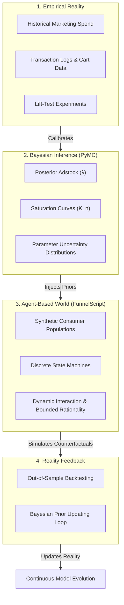

# DEBATES.md: Foundational Scientific & Architecture Debates

> Record of foundational philosophical debates, trade-off analyses, and resulting architectural decisions governing the FunnelScript ecosystem and its relationship to empirical reality.

---

## Executive Synthesis: The Core Dilemma

Building a Domain-Specific Language (DSL) for marketing is a solved software engineering problem (Lexer, Parser, AST, Linter). **The true scientific challenge is building a Simulated Market World whose emergent behavior can be trusted for real-world capital allocation.**

A simulation engine that outputs believable behavior is not necessarily predictively valid. In marketing, consumer agents operate in complex adaptive systems with non-linear feedback, exogenous volatility, and bounded rationality. FunnelScript addresses this through the **Tri-Pillar Separation Architecture**:

```
 ┌──────────────────────┐      ┌──────────────────────────┐      ┌─────────────────────────────┐
 │  1. Marketing DSL    │      │  2. Synthetic World      │      │  3. Reality Calibration    │
 │  (FunnelScript Core) │ ───> │  (Discrete-Event ABM)    │ <─── │  (PyMC Marketing MCP / MMM) │
 │  Tactics, Invariants │      │  Agents, Sinks, Latency  │      │  Priors, Saturation, Gates  │
 └──────────────────────┘      └──────────────────────────┘      └─────────────────────────────┘
```

---

## Debate 1: Human-Like LLM Agents vs. Parsimonious Calibrated Hybrid Agents

### The Conflict
* **Position A (Human-Like Persona Simulation):** Instantiate agents using Large Language Models (LLMs) with rich backstories, detailed memories, and conversational reasoning to mirror human qualitative nuances.
* **Position B (Scientific Hybrid ABM — *Adopted*):** Instantiate agents using a parsimonious set of mathematically bounded, observable behavioral variables (10–15 parameters), reserving LLMs strictly for complex qualitative choice heuristics where closed-form math is unavailable.

### Literature & Evidence Anchor
* **Stanford Agent Evaluation Study (Park et al., 2024 / Aher et al., 2023):** While agents parameterized with interview transcripts can mimic qualitative survey responses in narrow settings, uncalibrated LLM persona simulations exhibit severe distributional drift, lack physical budget conservation, and cannot reliably forecast macro market elasticities.
* **Wharton Marketing ABM Literature (Rand, Rust, 2011):** High-dimensional behavioral models suffer from parameter unidentifiability. A model with 100 uncalibrated psychological parameters is non-falsifiable; a model with 12 calibrated parameters grounded in empirical data possesses predictive validity.

### Resolution & Actionable Directives
1. **The Parsimony Invariant:** Core agent state must remain lightweight, vectorized, and mathematical:
   $$\theta_i = \langle \alpha_{\text{affinity}}, \beta_{\text{price}}, \gamma_{\text{fomo}}, \kappa_{\text{fatigue}}, w_{\text{wallet}}, \lambda_{\text{inertia}} \rangle$$
2. **Computational Feasibility:** Vectorized numeric agents scale to $N = 10^5$ agents per trial in NumPy/C ($< 15\text{ms}$/day). LLM-per-agent architectures collapse at scale ($10^5 \times \text{tokens} = \text{infeasible latency and cost}$).
3. **Selective LLM Injection:** LLMs may only be invoked in offline calibration passes to translate qualitative copy (e.g. ad creative text) into numeric parameter vectors ($q_{\text{ad}} \in [0, 1]$), never in the inner simulation loop.

---

## Debate 2: Deterministic Predictive Oracle vs. Stochastic Downside Stress-Testing

### The Conflict
* **The Fallacy:** Positioning FunnelScript as an infallible crystal ball: *"If you launch this strategy, you will generate exactly \$240,000 in revenue."*
* **The Reality:** Markets are open stochastic systems subject to irreducible aleatoric uncertainty and exogenous shocks (competitor price wars, ad platform auction volatility).

### Resolution & Actionable Directives
1. **Downside Risk & Catastrophe Detection over Point Forecasting:** FunnelScript’s primary mandate is to identify **structural vulnerabilities, failure boundaries, and capital insolvency cliffs** before spending real funds:
   * *Stable Baseline:* Does the unit economics hold under expected variance?
   * *Competitor Retaliation:* What happens if competitors cut prices by 25%?
   * *Auction Surge:* At what CPM increase does the campaign cross into negative cash flow?
   * *Cash-Flow Starvation:* Does payment gateway settlement delay ($\Delta_{\text{settle}}$) cause an ad spend freeze?
2. **Ensemble Monte Carlo Output:** All performance indicators must be delivered as probability densities (P10, P50, P90, VaR), never scalar guarantees.

---

## Debate 3: Micro-ABM vs. Macro-MMM — The `pymc-marketing-mcp` Synergy

### The Conflict & Opportunity
* **`pymc-marketing-mcp` (Macro-Level Bayesian Engine):**
  * *Input:* Real historical marketing spend, revenue time-series, lift-test outcomes.
  * *Capability:* 66 statistical methods covering Bayesian Marketing Mix Modeling (MMM), Adstock decay, Saturation curves (Hill/Michaelis-Menten), Incremental ROAS, and Statistical Decision Gates.
  * *Question Answered:* *"What did historical data prove about channel efficiency and uncertainty?"*
* **`FunnelScript` (Micro-Level Dynamic Execution Engine):**
  * *Input:* Tactical declarative strategies, touchpoint topologies, customer state machines.
  * *Capability:* Simulating discrete counterfactual scenarios, multi-step branching logic, and emergent behaviors (cannibalization, working capital freezes).
  * *Question Answered:* *"What will happen dynamically if we deploy this novel multi-step strategy tomorrow?"*

### The Integration Contract (Decoupled Statistical Bridge)
Rather than forcing an unmaintainable monolithic merge, both systems interface via an explicit **Calibration Contract**:

```
[Historical Real Data] 
         │
         ▼
[PyMC Marketing MCP]
   • Posterior Adstock Decay (λ)
   • Hill Half-Saturation (K, n)
   • Channel Marginal ROAS Prior
   • Statistical Decision Gate Status (diagnose_mmm)
         │
         │ (Calibration Export: `calibration_manifest.json`)
         ▼
[FunnelScript Simulation World]
   • Adstock & Fatigue Kernels parameterized by λ
   • Traffic Saturation Curves bounded by K
   • Volatility Sigma derived from Bayesian Posterior Uncertainty
   • Campaign Halted if Decision Gate FAILS
```

### Actionable Directives
1. **Decision Gate Inheritance:** If PyMC Marketing's diagnostic gates fail (e.g. `divergences > 0`, `r_hat > 1.05`, or `insufficient_spend_support`), FunnelScript must flag the simulation calibration as **UNVERIFIED / SYNTHETIC_ONLY**, preventing false confidence.
2. **Independent Lifecycles:** `funnelscript` and `pymc-marketing-mcp` retain separate repositories, releases, and CI suites, integrating via versioned JSON schemas (`FunnelScript Calibration Bridge v1.0`).

---

## Debate 4: Empirical Identifiability & The 4-Pillar Probabilistic World Model

### The Conflict & The Identifiability Barrier
A fundamental question arises: *Can real-world marketing data (such as MMM time series from PyMC Marketing) completely specify the micro-behavioral rules of synthetic agents?*

The mathematical answer is **No, due to the Identifiability Problem**. Consider the **3% Conversion Rate Paradox**:
Two fundamentally different consumer worlds produce the exact same aggregate empirical conversion rate of $3.0\%$:

| Dimension | World A: High Price Elasticity | World B: Brand Trust & Quality |
| :--- | :--- | :--- |
| **Micro-Demographics** | Consumers are bargain hunters ($\beta \gg 0.70$) | Consumers value trust and reliability ($\alpha \gg 0.70$) |
| **Purchase Driver** | Price discounting and flash promotions | Brand credibility, peer reviews, social proof |
| **Observed Baseline CR** | $3.0\%$ | $3.0\%$ |
| **Impact of a 20% Discount** | **Dramatic Surge:** CR jumps to $7.5\%$ | **Negligible / Negative:** CR remains $3.1\%$ (erodes margins) |

Historical macro data alone cannot distinguish between World A and World B. While Bayesian MMM (via `pymc-marketing-mcp`) accurately estimates channel-level response curves and saturation parameters ($K, \lambda$), deducing individual psychological propensities requires explicit behavioral hypotheses and experimental lift tests.



### The 4-Pillar Probabilistic World Model Architecture
To guarantee scientific grounding, every FunnelScript world must be synthesized from four interdependent layers:
1. **Empirical Reality:** The physical ground truth: historical sales, ad platform billing, customer cohort churn, and experimental lift tests.
2. **Bayesian Inference:** Macro-parameter estimation preserving full posterior uncertainty (P10, P50, P90) rather than fragile point estimates.
3. **Agent-Based World:** Synthetic populations governed by discrete state transition matrices, budget constraints, and psychological decision kernels.
4. **Reality Feedback:** Continuous validation of simulation trajectories against out-of-sample real performance, updating world priors when divergence is detected.

### Progressive World Specialization
Markets are geographically and structurally heterogeneous. A retail fast-moving consumer goods (FMCG) market in Egypt possesses different purchasing cadence, cash-on-delivery reliance, and inflation volatility compared to an enterprise B2B SaaS sales cycle in Saudi Arabia. FunnelScript adopts **Progressive Specialization**:
* **Level 0 (Generalized Baseline):** An uncalibrated prototype running on industry reference priors.
* **Level 1 (Empirically Calibrated):** Incorporates enterprise MMM priors (`calibration_manifest.json`) from `pymc-marketing-mcp`.
* **Level 2 (Fully Identified Digital Twin):** Augmented with customer-level event streams and lift-test experiments, narrowing the behavioral envelope.

---

## Debate 5: Cognitive Continuity & Multi-Tier Agent Architecture (The `OmniTwin` Bridge)

### Cognitive Continuity vs. Market Simulation
The analysis of [`imMamdouhaboammar/OmniTwin`](https://github.com/imMamdouhaboammar/OmniTwin) reveals a critical technological asset: a **Cognitive Continuity Engine** featuring:
- **Hierarchical Memory** (retaining past touchpoint impressions and sentiment).
- **State Reducer** (updating internal psychological valence across interactions).
- **Turn Planner & Cognitive Planner** (contextual response formulation).
- **Allostasis Engine** (modeling cognitive load and fatigue).
- **Contour Access Layer** (evidence-bounded claims).

However, a fundamental architectural dilemma emerges when applying cognitive continuity to market simulation:

### 1. The Epistemological Boundary: World Truth vs. Agent Belief
In cognitive AI systems, principles like *"No ID, No Claim"* prevent hallucinations by restricting agents to verifiable memories. In **human consumer simulation**, this constraint is fatal if applied universally:
* **World Truth:** The objective reality of the market (e.g. the actual product defect rate is 0.1%; the competitor's price is $80).
* **Agent Belief:** The subjective, imperfect perception held by a human consumer (e.g. the agent believes a false negative rumor, miscalculates a discount, or overestimates product complexity).

Human markets are driven by bounded rationality, informational asymmetry, and subjective cognitive bias. Therefore:
$$\text{Belief}_i(t) \neq \text{WorldTruth}(t)$$
The simulation engine must strictly decouple the **Physical World Environment** from each **Agent's Subjective Epistemic State**.

### 2. The Two-Tier Agent Scaling Paradigm
Instantiating $100,000$ agents each powered by an active LLM and hierarchical memory graph causes insurmountable computational collapse:
$$\mathcal{O}(N \times \text{LLM Call Latency}) \implies 10^5 \times 500\text{ms} \approx 13.8\text{ hours per simulation tick}$$

FunnelScript resolves this via a **Two-Tier Hybrid Architecture**:

```
┌─────────────────────────────────────────────────────────────────────────────────┐
│                           Two-Tier Agent Hierarchy                              │
│                                                                                 │
│   ┌─────────────────────────────────────────────────────────────────────────┐   │
│   │ Tier 1: Vectorized Population Agents (N = 10^5 - 10^6)                  │   │
│   │ • Lightweight SIMD NumPy/C numeric tensors: (α, β, γ, w, s)             │   │
│   │ • Discrete stochastic transition kernels (< 20ns per evaluation)        │   │
│   │ • Primary purpose: Statistical significance, macro curves, VaR/CVaR     │   │
│   └─────────────────────────────────────────────────────────────────────────┘   │
│                                        ▲                                        │
│                                        │ (Stratified Sampling & Calibration)    │
│                                        ▼                                        │
│   ┌─────────────────────────────────────────────────────────────────────────┐   │
│   │ Tier 2: Cognitive Sentinel Agents (N = 10^1 - 10^2, via OmniTwin)       │   │
│   │ • Full hierarchical memory, state reducer, and sentiment allostasis     │   │
│   │ • Qualitative reasoning, copy resonance, and message interpretation     │   │
│   │ • Primary purpose: Creative pre-testing and narrative plausibility      │   │
│   └─────────────────────────────────────────────────────────────────────────┘   │
└─────────────────────────────────────────────────────────────────────────────────┘
```

---

## Debate 6: The Foundational Paradigm Shift — A Domain-Specific Language vs. A Marketing Tool

### The Core Thesis: FunnelScript is the SQL of Marketing Systems
The most critical realization of the project: **FunnelScript is NOT a marketing simulation software tool; it is a general-purpose Domain-Specific Programming Language (DSL).**

Just as SQL provides relational algebra primitives (`SELECT`, `JOIN`, `WHERE`, `GROUP BY`, `TRANSACTION`) without hardcoding the schema of a specific company's database:
* FunnelScript must provide computational primitives for marketing systems, economic entities, state transitions, and stochastic events.
* FunnelScript must **never** hardcode assumptions about a specific market (e.g. "consumers are price sensitive by 0.5" or "Egypt has a 3-day delivery lag").
* Developers and the community must be empowered to build specialized domain libraries and market representations on top of the language.

### Separation Matrix: Core Language vs. Community Ecosystem

| Layer | FunnelScript Core Language | Community Libraries & Ecosystem |
| :--- | :--- | :--- |
| **Syntax & Semantics** | Grammar, AST, Parser, Type System | Domain-specific macros, business blueprints |
| **Execution Engine** | Discrete-event calendar, SIMD runtime | Regional market profiles (Egypt FMCG, Saudi B2B SaaS) |
| **Probability & Math** | Distribution primitives, stochastic draws | Specific psychological heuristic models |
| **Verification** | Invariant checking, cycle detection, reachability | Industry compliance linters (Healthcare, Fintech) |
| **Ecosystem Bridges** | Pluggable Calibration & Memory Contracts | `pymc-marketing-adapter`, `omnitwin-memory-bridge` |

### Decoupling Compiler Invariants from Specific Economic Assumptions
In early iterations of FunnelScript, certain economic rules (e.g. strict population mass conservation $\sum N = N_{\text{total}}$, zero-credit wallet constraints $w \ge P$, and liquid cash halts) were hardcoded into the runtime. 

In a true programming language, these are **model-specific constraints**, not universal linguistic axioms:
* In a market with viral adoption or high churn, population mass $\mathcal{P}(t)$ is dynamic ($N(t) \neq \text{const}$).
* In a market with Buy Now, Pay Later (BNPL) or consumer credit, purchases occur where price exceeds instantaneous liquid wallet balance ($P > w$).
* In an enterprise with an overdraft or revolving credit facility, ad spend continues even when cash balance dips below zero.

**Resolution:** The FunnelScript Core Language introduces generic constraint declaration primitives:
```ebnf
ConstraintDeclaration ::= "constraint" Identifier "{" Expression "}"
```
This enables the developer or standard library to express `constraint MassConservation { sum(state) == total_population }` or `constraint SolvencyHalt { liquid_cash >= 0 }` explicitly, preserving absolute expressive freedom for non-traditional markets.

### The Standard Library Architecture: Minimal Kernel + `std::marketing`
To ensure both computational purity and rich marketing ergonomics, FunnelScript adopts the classic language design pattern (seen in Rust and Julia):
1. **Minimal Computational Kernel:**
   * Primitives: `entity`, `agent`, `state`, `event`, `transition`, `rule`, `probability`, `constraint`.
2. **Official Standard Library (`std::marketing`):**
   * Pre-packaged abstractions built using the core primitives:
     * `std::marketing::Audience`
     * `std::marketing::Touchpoint` (`PaidTraffic`, `ConversionSurface`, `EmailChannel`)
     * `std::marketing::Metrics` (`ROAS`, `CAC`, `CLV`, `Cannibalization`)
     * `std::marketing::Economics` (`WorkingCapital`, `SettlementQueue`, `CashRuin`)

### The Generalization Litmus Test
FunnelScript is scientifically verified as a true programming language if and only if:
> **The Litmus Test:** An engineer can model a cash-on-delivery retail consumer electronics campaign in Egypt, and a second engineer can model a 9-month enterprise B2B SaaS procurement cycle in Saudi Arabia, running on the exact same FunnelScript compiler and simulation runtime without modifying a single line of core compiler code.

---

## Debate 7: The 4-Layer Architecture Consensus & The Computational Model

### The Consensus: A General DSL with Official Standard Libraries
Following collaborative design deliberation, the fundamental character of FunnelScript is solidified as a **foundational programming language with a minimal mathematical kernel, coupled with an official first-party marketing standard library and an open community ecosystem.**

FunnelScript does not build hardcoded tools or static market simulations; it delivers the language substrate upon which arbitrary market systems, strategies, and economic interactions are authored and executed.

```
┌─────────────────────────────────────────────────────────────────────────────┐
│                       The 4-Tier FunnelScript Stack                         │
│                                                                             │
│  ┌───────────────────────────────────────────────────────────────────────┐  │
│  │ Tier 04: Community Package Ecosystem                                  │  │
│  │ Market Models (EG/KSA/US), Behavioral Heuristics, Sector Blueprints,  │  │
│  │ Third-Party Statistical Adapters, Custom Heuristic Engines            │  │
│  └───────────────────────────────────────────────────────────────────────┘  │
│                                     ▲                                        │
│                                     │ Extends & Implements                   │
│  ┌───────────────────────────────────────────────────────────────────────┐  │
│  │ Tier 03: Official Marketing Standard Library (First-Party)            │  │
│  │ Audience, Campaign, Touchpoint, Conversion, Attribution, Budget,     │  │
│  │ Customer Journey, Adstock Decay, Lift Calibration                     │  │
│  └───────────────────────────────────────────────────────────────────────┘  │
│                                     ▲                                        │
│                                     │ Built With                             │
│  ┌───────────────────────────────────────────────────────────────────────┐  │
│  │ Tier 02: Reference Execution Runtime                                  │  │
│  │ Discrete-Event Calendar (DES), Stochastic Sampler, State Engine,      │  │
│  │ Deterministic Replay, Invariant Enforcer, Telemetry Aggregator        │  │
│  └───────────────────────────────────────────────────────────────────────┘  │
│                                     ▲                                        │
│                                     │ Executes                               │
│  ┌───────────────────────────────────────────────────────────────────────┐  │
│  │ Tier 01: FunnelScript Language Core (Foundational Kernel)             │  │
│  │ Grammar, Type System, AST, Entity, Agent, State, Event, Rule,         │  │
│  │ Transition, Probability Primitives, Constraints, Modules              │  │
│  └───────────────────────────────────────────────────────────────────────┘  │
└─────────────────────────────────────────────────────────────────────────────┘
```

### The Three Architectural Governance Axioms

#### Axiom 1: Complete World-Model Neutrality
The language core imposes **zero predefined market assumptions**. A user can construct an agent-based consumer market featuring $10^6$ synthetic agents, while another user constructs a deterministic enterprise account-based marketing (ABM) model containing zero consumer agents. Both programs are equally valid if they obey the syntactic and semantic type rules of the language.

#### Axiom 2: First-Party Standard Library Parity (No Privileged APIs)
The official standard library (`std::marketing`) must be authored strictly using the **public extension interfaces and syntax** available to any third-party package developer. If first-party marketing primitives require internal compiler privileges or hardcoded compiler branches, the language design is defective. Community developers must possess the identical expressive capability to invent alternative marketing paradigms (e.g. `affiliate_network`, `influencer_graph`, or `b2b_procurement`).

#### Axiom 3: Strict Separation of Programmatic Verification vs. Scientific Validation
The compiler and static linter are responsible exclusively for **computational correctness**:
* Syntax parsing & lexical tokenization.
* Type safety and state reachability.
* Directed graph acyclicity (where forward flow is asserted).
* Constraint consistency.

The compiler **never** passes judgment on economic realism. A strategy that assumes 90% conversion rates is computationally valid; its empirical plausibility must be evaluated externally through Bayesian calibration (`pymc-marketing-mcp`) and out-of-sample backtesting.

---

## Debate 8: The Computational Model — Ontological Distinction between `Entity` and `Agent`

Before formalizing new syntax, the foundational execution semantics of FunnelScript must define the ontological primitives that populate a program and govern how time advances.

### 1. The Ontological Subtyping Principle: $\text{Agent} \subset \text{Entity}$
Every agent is an entity, but not every entity is an agent:

$$\text{Agent} \subset \text{Entity}$$

```
┌──────────────────────────────────────────────┐
│                    Entity                    │
│   Identity, Attributes, State, Lifespan      │
│   (Passive, Reactive, Externally Mutated)   │
│   Examples: Inventory, Budget, AdSlot, Cash  │
│                                              │
│         ┌───────────────────────────┐        │
│         │           Agent           │        │
│         │   Autonomous Behavior,    │        │
│         │   Decision Heuristics,    │        │
│         │   Self-Initiated Action   │        │
│         │   Examples: Consumer,     │        │
│         │   Competitor, Bidder      │        │
│         └───────────────────────────┘        │
└──────────────────────────────────────────────┘
```

| Ontological Dimension | `Entity` (Base Object) | `Agent` (Autonomous Actor) |
| :--- | :--- | :--- |
| **Definition** | An economic or structural object possessing identity, mutable attributes, and state. | An entity possessing bounded rationality, internal decision rules, and autonomous initiation. |
| **Agency** | **Passive / Reactive:** State changes occur via external event dispatch or agent manipulation. | **Active / Proactive:** Initiates actions, executes choices, and triggers events affecting other entities. |
| **Internal Mechanics** | State storage, capacity boundaries, depletion counters. | Utility functions, cognitive heuristics, memory stores, probabilistic choice kernels. |
| **Domain Examples** | `Budget`, `WarehouseInventory`, `AdUnitSlot`, `WorkingCapitalAccount`, `CouponPool`. | `ConsumerCohort`, `CompetitorFirm`, `AlgorithmicAdBidder`, `SalesRepresentative`. |

### 2. The Core Algebraic Primitives of the Computational Model
A FunnelScript program $\mathcal{M}$ is defined as a 7-tuple:

$$\mathcal{M} = \langle \mathcal{E}, \mathcal{A}, \mathcal{S}, \mathcal{V}, \mathcal{R}, \mathcal{T}, \mathcal{C} \rangle$$

Where:
1. $\mathcal{E}$ is the set of **Entities** (passive state containers).
2. $\mathcal{A} \subseteq \mathcal{E}$ is the set of **Agents** (autonomous decision actors).
3. $\mathcal{S}$ is the set of **Discrete States** defined across entity lifecycles.
4. $\mathcal{V}$ is the set of **Events** scheduled across the simulation calendar.
5. $\mathcal{R}$ is the set of **Behavioral Rules** (deterministic or stochastic functions $f: (\text{State}, \text{Context}) \to \text{Action}$).
6. $\mathcal{T}$ is the **Time-Advance Model** (hybrid fixed-increment $\Delta t$ and next-event scheduling $\tau$).
7. $\mathcal{C}$ is the set of **Model-Level Constraints** (user-defined invariants enforced during execution).

---

## Debate 9: Execution Semantics — Discrete-Event Scheduling (DES) vs. Fixed-Tick Progression

### 1. The Multi-Timescale Dilemma in Marketing Realities
Marketing systems operate across vastly divergent temporal scales:
* **Sub-second ($10^{-3} - 10^0\text{ s}$):** Real-time ad exchange RTB auctions, clickstream tracking, webhooks.
* **Minute-scale ($10^1 - 10^2\text{ min}$):** On-site browsing sessions, live chat engagements, payment authorization handshakes.
* **Hour-scale ($10^0 - 10^1\text{ h}$):** Abandoned cart email automations, transactional notifications, flash-sale countdown expirations.
* **Day-scale ($10^0 - 10^1\text{ days}$):** Adstock carryover decay ($\lambda$), credit card settlement clearing delays ($\Delta_{\text{settle}}$), retargeting audience membership windows.
* **Month-scale ($10^1 - 10^2\text{ days}$):** Subscription billing cycles, cohort churn, customer lifetime value (CLV) realization.

If an execution runtime relies solely on a fine-grained fixed-increment tick model ($\Delta t = 1\text{ second}$), simulating a 90-day campaign requires $7,776,000$ loop evaluations per agent. For $10^5$ agents, this results in $> 7.7 \times 10^{11}$ evaluations, 99.99% of which evaluate empty, unchanged states.
Conversely, if the engine steps at $\Delta t = 1\text{ day}$, it cannot evaluate intraday causal triggers, such as a 2-hour cart abandonment incentive email.

### 2. The Theoretical Synthesis: Zeigler's DEVS Formalism & Vectorized Batching
To reconcile computational scalability with multi-timescale fidelity, FunnelScript unifies Bernard Zeigler’s **Discrete Event Systems Specification (DEVS)** with SIMD array batching:
1. **The Event Priority Calendar:** The simulation driver maintains an event priority queue $\mathcal{Q}$ ordered chronologically by execution timestamp $\tau_e$ and tie-break priority $\pi_e$:
   $$\mathcal{Q} = \{ e_1, e_2, \dots, e_m \}, \quad \tau_{e_k} \le \tau_{e_{k+1}}$$
2. **Next-Event Time Jump:** The global simulation clock $t$ advances discontinuously to the timestamp of the head event:
   $$t \leftarrow \tau_{\text{head}} = \min_{e \in \mathcal{Q}} \tau_e$$
3. **Continuous Process Integration via Analytic Step Functions:** For continuous background phenomena (such as adstock decay or brand affinity depreciation), states are not updated every microsecond. Instead, they are lazily evaluated analytically whenever an agent encounters an active event at time $t$:
   $$\beta(t) = \beta(t_0) \cdot e^{-\lambda (t - t_0)}$$
4. **Vectorized Micro-Batching:** When an event affects a macro cohort (e.g. `AdImpressionBatchEvent` affecting $50,000$ synthetic agents simultaneously), the runtime executes vectorized NumPy SIMD operations across the entire slice in a single pass.

```
┌────────────────────────────────────────────────────────────────────────┐
│                        Discrete-Event Calendar                         │
│                                                                        │
│   t=0.0s          t=2.5h            t=24.0h           t=72.0h          │
│  [Ad Batch] ────> [Cart Recovery] ─> [Settlement] ──> [Cohort Churn]   │
│     │                    │                 │                 │         │
│     ▼                    ▼                 ▼                 ▼         │
│  Vectorized          Targeted           Financial         Absorbing    │
│  SIMD Slice          Sub-Cohort         Ledger            State        │
│  (50k agents)        (1,200 agents)     Update            Transition   │
└────────────────────────────────────────────────────────────────────────┘
```

### 3. The Global World State Transition Equation
Formally, the FunnelScript execution runtime is governed by the state transition kernel $\mathcal{T}$:

$$W_{t^+} = \mathcal{T}(W_t, e_t, \theta, \xi_t)$$

Where:
* $W_t \in \mathcal{W}$ is the global world state at time $t$, comprising all entity records $\mathcal{E}$ and agent state vectors $\mathcal{A}$.
* $e_t = \langle \tau_t, \text{type}, \text{target}, \text{payload} \rangle \in \mathcal{Q}$ is the scheduled event popped from the priority calendar.
* $\theta \in \Theta$ is the immutable compiled strategy ruleset and parameter vector.
* $\xi_t \sim \mathcal{D}(\cdot)$ is a cryptographically deterministic pseudo-random innovation drawn from the simulation PRNG stream.
* $\mathcal{T}: \mathcal{W} \times \mathcal{E}_{\text{event}} \times \Theta \times \Xi \to \mathcal{W}$ is the deterministic transition operator that updates state and schedules future events $\mathbf{E}_{\text{new}} \subset \mathcal{Q}$.

### 4. The Deterministic Replay Invariant
Every simulation run must satisfy the **Bit-for-Bit Deterministic Replay Invariant**:

$$\text{Trace}(W_0, \mathbf{E}_0, \text{seed}, \theta) \equiv \text{Trace}'(W_0, \mathbf{E}_0, \text{seed}, \theta)$$

Given identical initial state $W_0$, initial event schedule $\mathbf{E}_0$, random seed $\sigma$, and compiled rules $\theta$, two runs on separate compute nodes must produce strictly identical telemetry metrics, cash balances, and agent state distributions. This invariant is essential for debugging, counterfactual sensitivity audits, and cryptographic auditability.

---

## Debate 10: Dual-Mode Execution & The Algebraic Effect System (Simulation vs. Shadow vs. Live)

### 1. The Architectural Dilemma: DSL Purity vs. Production Execution
A critical tension emerged in the architectural design of FunnelScript:
* *Position A (Pure Simulation):* FunnelScript should remain strictly an offline modeling language. Live marketing execution should be left entirely to external automation tools (Zapier, Make, custom cron scripts).
* *Position B (Unified Execution Language):* If FunnelScript only simulates, strategies will suffer from the classic "Simulation-to-Reality Gap" (Sim2Real gap). Marketers will design sophisticated strategies in code, but execute crude, dumbed-down approximations in production ad managers.

### 2. The Peril of Mixed Side-Effects
If live execution is bolted directly into the language syntax (e.g. statements like `meta.adjust_budget()` or `klaviyo.send_email()`), the language becomes catastrophic to test:
1. Running a simulation trial risks accidentally firing live webhooks and spending real corporate capital.
2. In-memory unit tests require complex mocking of external HTTP endpoints.
3. Live network latencies destroy Monte Carlo simulation throughput (dropping performance from $60\text{M agent-days/sec}$ to $10\text{ ops/sec}$).

### 3. The Algebraic Effect System (Koka-Inspired Intent Architecture)
To achieve flawless unity without compromising purity or safety, FunnelScript implements an **Algebraic Effect System** separating **Tactical Intent** from **Effect Interpretation**:

```
┌────────────────────────────────────────────────────────┐
│             FunnelScript Pure Strategy Logic           │
│       Emits Pure Declarative Effect Intents Only       │
└───────────────────────────┬────────────────────────────┘
                            │
               emits EffectIntent(type, payload)
                            │
                            ▼
        ┌───────────────────────────────────────┐
        │       Pluggable Effect Handlers       │
        └───────┬───────────────┬───────────────┘
                │               │               │
  ┌─────────────▼────┐  ┌───────▼───────────┐  ┌▼──────────────────┐
  │ Simulation Mode  │  │   Shadow Mode     │  │    Live Mode      │
  │ Mutates in-memory│  │ Ingests live data,│  │ Enforces limits,  │
  │ synthetic arrays │  │ verifies rules,   │  │ signs payloads,   │
  │ Zero I/O         │  │ zero side-effects │  │ calls real APIs   │
  └──────────────────┘  └───────────────────┘  └───────────────────┘
```

The compiled strategy logic never invokes HTTP clients directly. Instead, when an action rule triggers, it yields a pure, immutable **`EffectIntent`** value:
* `AdjustBudgetIntent(touchpoint_id, delta_amount, currency)`
* `DispatchMessageIntent(channel, recipient_cohort, template_id, parameters)`
* `CreateIncentiveIntent(code, discount_pct, expiration_hours)`
* `HaltSpendIntent(reason, urgency_level)`

### 4. Tri-Modal Execution Targets
The runtime environment provides three interchangeable effect handlers:

#### Target 1: Simulation Mode (Pure Functional)
* **Execution Boundary:** Hermetic, in-memory compute sandbox.
* **Mechanics:** `SimulatedEffectHandler` captures intents and applies mutations directly to synthetic agent vector arrays, virtual touchpoint counters, and simulated bank balance sheets.
* **Performance:** Executes at $> 50\text{M agent-days/sec}$ with zero network I/O and zero latency.

#### Target 2: Shadow Execution Mode (Passive Observational Bridge)
* **Execution Boundary:** Production read-only mirror.
* **Mechanics:** Subscribes to production event streams via webhooks (Shopify order feeds, Meta spend webhooks, Stripe charge events). Evaluates the FunnelScript strategy state machine against real traffic in real time. Emits zero outbound mutations.
* **Purpose:** Quantifies divergence between simulated expectations and empirical market dynamics ($\Delta_{\text{actual vs predicted}}$) before granting live execution permissions.

#### Target 3: Live Execution Mode (Imperative with Safety Guardrails)
* **Execution Boundary:** Production stateful gateway.
* **Mechanics:** `LiveEffectHandler` intercepts intents, passes them through a **Hard Safety Policy Filter**, attaches cryptographic idempotency keys, and dispatches authenticated payloads via Provider Adapters (Meta Marketing API, Klaviyo API, Shopify Admin API).
* **Guarantees:**
  * **Hard Spend Ceilings:** Max daily budget limit ($C_{\text{daily\_cap}}$) enforced at the runtime driver layer, preventing accidental runaway spend regardless of script logic bugs.
  * **Idempotency Keys:** Every mutation includes a unique hash $\text{Key} = \text{SHA256}(\text{strategy\_id} \parallel \text{event\_id} \parallel t_{\text{sched}})$, preventing double-billing on network retries.
  * **Compensating Actions:** Because marketing side-effects (e.g. emails, SMS, published ad sets) cannot be rolled back with database `ROLLBACK`, irreversible effects require declared **Compensating Actions** (e.g. immediate discount deactivation or automated correction broadcasts).

---

## Actionable Operational Checklist

| # | Domain | Actionable Specification | Priority | Status |
| :--- | :--- | :--- | :--- | :--- |
| **1** | **Agent Representation** | Restrict agent micro-foundations to 10–15 measurable variables; enforce strict vectorization. | P0 | **Implemented** |
| **2** | **Static Verification** | Enforce DAG reachability and cycle detection in AST linter before any simulation run. | P0 | **Implemented** |
| **3** | **Liquidity Invariant** | Model gateway settlement latency $\Delta_{\text{settle}}$ and enforce $P(\text{Insolvency})$ ad halt. | P0 | **Implemented** |
| **4** | **Two-Tier Engine** | Keep vectorized SIMD runtime for $10^5$ population agents; reserve cognitive agents for sampling. | P0 | **Implemented** |
| **5** | **General Core DSL** | Decouple hardcoded marketing entities into minimal kernel (`entity`, `agent`, `state`, `event`). | P1 | **Next Phase** |
| **6** | **Standard Library (`std::marketing`)** | Re-implement `Audience`, `Touchpoint`, and `Campaign` as first-party library abstractions over the kernel. | P1 | **Next Phase** |
| **7** | **Calibration Contract** | Implement `schema/calibration_manifest.json` bridge to ingest Bayesian priors from `pymc-marketing-mcp`. | P1 | **Next Phase** |
| **8** | **Subjective Belief Layer** | Formalize separation of `WorldTruth` and `AgentBelief` to support imperfect consumer heuristics. | P2 | **Roadmap** |
| **9** | **OmniTwin Memory Adapter** | Develop optional adapter for Tier-2 cognitive agents to conduct narrative copy pre-testing. | P2 | **Roadmap** |
| **10** | **Empirical Validation** | Backtest simulation outputs against historical incrementality lift tests to measure empirical coverage. | P2 | **Roadmap** |
| **11** | **DES Calendar Engine** | Implement min-heap priority queue $\mathcal{Q}$ for multi-timescale discrete-event simulation. | P1 | **Next Phase** |
| **12** | **Algebraic Effect System** | Author pure `EffectIntent` types and pluggable handlers (`SimulatedEffectHandler`, `ShadowEffectHandler`, `LiveEffectHandler`). | P1 | **Next Phase** |
| **13** | **Shadow Execution Mode** | Build real-time webhook ingestion bridge to track $\Delta_{\text{actual vs predicted}}$ without live mutations. | P2 | **Roadmap** |
| **14** | **Provider Adapters** | Implement provider abstraction contracts for Meta Marketing API, Klaviyo, and Shopify Admin API. | P2 | **Roadmap** |
| **15** | **Safety Guardrails** | Implement non-bypassable spend rate-limiters, daily burn ceilings, and SHA-256 idempotency keying. | P1 | **Next Phase** |

