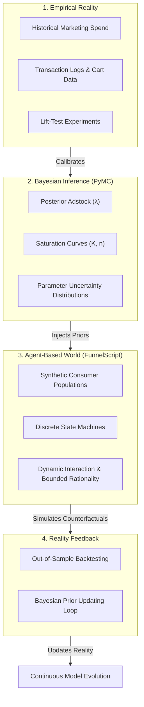

# DEBATES.md: Foundational Scientific & Architecture Debates

> Record of foundational philosophical debates, trade-off analyses, and resulting architectural decisions governing the FunnelScript ecosystem and its relationship to empirical reality.

---

## Executive Synthesis: The Core Dilemma

Building a Domain-Specific Language (DSL) for marketing is a solved software engineering problem (Lexer, Parser, AST, Linter). **The true scientific challenge is building a Simulated Market World whose emergent behavior can be trusted for real-world capital allocation.**

A simulation engine that outputs believable behavior is not necessarily predictively valid. In marketing, consumer agents operate in complex adaptive systems with non-linear feedback, exogenous volatility, and bounded rationality. FunnelScript addresses this through the **Tri-Pillar Separation Architecture**:

```
 ┌──────────────────────┐      ┌──────────────────────────┐      ┌─────────────────────────────┐
 │  1. Marketing DSL    │      │  2. Synthetic World      │      │  3. Reality Calibration    │
 │  (FunnelScript Core) │ ───> │  (Discrete-Event ABM)    │ <─── │  (PyMC Marketing MCP / MMM) │
 │  Tactics, Invariants │      │  Agents, Sinks, Latency  │      │  Priors, Saturation, Gates  │
 └──────────────────────┘      └──────────────────────────┘      └─────────────────────────────┘
```

---

## Debate 1: Human-Like LLM Agents vs. Parsimonious Calibrated Hybrid Agents

### The Conflict
* **Position A (Human-Like Persona Simulation):** Instantiate agents using Large Language Models (LLMs) with rich backstories, detailed memories, and conversational reasoning to mirror human qualitative nuances.
* **Position B (Scientific Hybrid ABM — *Adopted*):** Instantiate agents using a parsimonious set of mathematically bounded, observable behavioral variables (10–15 parameters), reserving LLMs strictly for complex qualitative choice heuristics where closed-form math is unavailable.

### Literature & Evidence Anchor
* **Stanford Agent Evaluation Study (Park et al., 2024 / Aher et al., 2023):** While agents parameterized with interview transcripts can mimic qualitative survey responses in narrow settings, uncalibrated LLM persona simulations exhibit severe distributional drift, lack physical budget conservation, and cannot reliably forecast macro market elasticities.
* **Wharton Marketing ABM Literature (Rand, Rust, 2011):** High-dimensional behavioral models suffer from parameter unidentifiability. A model with 100 uncalibrated psychological parameters is non-falsifiable; a model with 12 calibrated parameters grounded in empirical data possesses predictive validity.

### Resolution & Actionable Directives
1. **The Parsimony Invariant:** Core agent state must remain lightweight, vectorized, and mathematical:
   $$\theta_i = \langle \alpha_{\text{affinity}}, \beta_{\text{price}}, \gamma_{\text{fomo}}, \kappa_{\text{fatigue}}, w_{\text{wallet}}, \lambda_{\text{inertia}} \rangle$$
2. **Computational Feasibility:** Vectorized numeric agents scale to $N = 10^5$ agents per trial in NumPy/C ($< 15\text{ms}$/day). LLM-per-agent architectures collapse at scale ($10^5 \times \text{tokens} = \text{infeasible latency and cost}$).
3. **Selective LLM Injection:** LLMs may only be invoked in offline calibration passes to translate qualitative copy (e.g. ad creative text) into numeric parameter vectors ($q_{\text{ad}} \in [0, 1]$), never in the inner simulation loop.

---

## Debate 2: Deterministic Predictive Oracle vs. Stochastic Downside Stress-Testing

### The Conflict
* **The Fallacy:** Positioning FunnelScript as an infallible crystal ball: *"If you launch this strategy, you will generate exactly \$240,000 in revenue."*
* **The Reality:** Markets are open stochastic systems subject to irreducible aleatoric uncertainty and exogenous shocks (competitor price wars, ad platform auction volatility).

### Resolution & Actionable Directives
1. **Downside Risk & Catastrophe Detection over Point Forecasting:** FunnelScript’s primary mandate is to identify **structural vulnerabilities, failure boundaries, and capital insolvency cliffs** before spending real funds:
   * *Stable Baseline:* Does the unit economics hold under expected variance?
   * *Competitor Retaliation:* What happens if competitors cut prices by 25%?
   * *Auction Surge:* At what CPM increase does the campaign cross into negative cash flow?
   * *Cash-Flow Starvation:* Does payment gateway settlement delay ($\Delta_{\text{settle}}$) cause an ad spend freeze?
2. **Ensemble Monte Carlo Output:** All performance indicators must be delivered as probability densities (P10, P50, P90, VaR), never scalar guarantees.

---

## Debate 3: Micro-ABM vs. Macro-MMM — The `pymc-marketing-mcp` Synergy

### The Conflict & Opportunity
* **`pymc-marketing-mcp` (Macro-Level Bayesian Engine):**
  * *Input:* Real historical marketing spend, revenue time-series, lift-test outcomes.
  * *Capability:* 66 statistical methods covering Bayesian Marketing Mix Modeling (MMM), Adstock decay, Saturation curves (Hill/Michaelis-Menten), Incremental ROAS, and Statistical Decision Gates.
  * *Question Answered:* *"What did historical data prove about channel efficiency and uncertainty?"*
* **`FunnelScript` (Micro-Level Dynamic Execution Engine):**
  * *Input:* Tactical declarative strategies, touchpoint topologies, customer state machines.
  * *Capability:* Simulating discrete counterfactual scenarios, multi-step branching logic, and emergent behaviors (cannibalization, working capital freezes).
  * *Question Answered:* *"What will happen dynamically if we deploy this novel multi-step strategy tomorrow?"*

### The Integration Contract (Decoupled Statistical Bridge)
Rather than forcing an unmaintainable monolithic merge, both systems interface via an explicit **Calibration Contract**:

```
[Historical Real Data] 
         │
         ▼
[PyMC Marketing MCP]
   • Posterior Adstock Decay (λ)
   • Hill Half-Saturation (K, n)
   • Channel Marginal ROAS Prior
   • Statistical Decision Gate Status (diagnose_mmm)
         │
         │ (Calibration Export: `calibration_manifest.json`)
         ▼
[FunnelScript Simulation World]
   • Adstock & Fatigue Kernels parameterized by λ
   • Traffic Saturation Curves bounded by K
   • Volatility Sigma derived from Bayesian Posterior Uncertainty
   • Campaign Halted if Decision Gate FAILS
```

### Actionable Directives
1. **Decision Gate Inheritance:** If PyMC Marketing's diagnostic gates fail (e.g. `divergences > 0`, `r_hat > 1.05`, or `insufficient_spend_support`), FunnelScript must flag the simulation calibration as **UNVERIFIED / SYNTHETIC_ONLY**, preventing false confidence.
2. **Independent Lifecycles:** `funnelscript` and `pymc-marketing-mcp` retain separate repositories, releases, and CI suites, integrating via versioned JSON schemas (`FunnelScript Calibration Bridge v1.0`).

---

## Debate 4: Empirical Identifiability & The 4-Pillar Probabilistic World Model

### The Conflict & The Identifiability Barrier
A fundamental question arises: *Can real-world marketing data (such as MMM time series from PyMC Marketing) completely specify the micro-behavioral rules of synthetic agents?*

The mathematical answer is **No, due to the Identifiability Problem**. Consider the **3% Conversion Rate Paradox**:
Two fundamentally different consumer worlds produce the exact same aggregate empirical conversion rate of $3.0\%$:

| Dimension | World A: High Price Elasticity | World B: Brand Trust & Quality |
| :--- | :--- | :--- |
| **Micro-Demographics** | Consumers are bargain hunters ($\beta \gg 0.70$) | Consumers value trust and reliability ($\alpha \gg 0.70$) |
| **Purchase Driver** | Price discounting and flash promotions | Brand credibility, peer reviews, social proof |
| **Observed Baseline CR** | $3.0\%$ | $3.0\%$ |
| **Impact of a 20% Discount** | **Dramatic Surge:** CR jumps to $7.5\%$ | **Negligible / Negative:** CR remains $3.1\%$ (erodes margins) |

Historical macro data alone cannot distinguish between World A and World B. While Bayesian MMM (via `pymc-marketing-mcp`) accurately estimates channel-level response curves and saturation parameters ($K, \lambda$), deducing individual psychological propensities requires explicit behavioral hypotheses and experimental lift tests.



### The 4-Pillar Probabilistic World Model Architecture
To guarantee scientific grounding, every FunnelScript world must be synthesized from four interdependent layers:
1. **Empirical Reality:** The physical ground truth: historical sales, ad platform billing, customer cohort churn, and experimental lift tests.
2. **Bayesian Inference:** Macro-parameter estimation preserving full posterior uncertainty (P10, P50, P90) rather than fragile point estimates.
3. **Agent-Based World:** Synthetic populations governed by discrete state transition matrices, budget constraints, and psychological decision kernels.
4. **Reality Feedback:** Continuous validation of simulation trajectories against out-of-sample real performance, updating world priors when divergence is detected.

### Progressive World Specialization
Markets are geographically and structurally heterogeneous. A retail fast-moving consumer goods (FMCG) market in Egypt possesses different purchasing cadence, cash-on-delivery reliance, and inflation volatility compared to an enterprise B2B SaaS sales cycle in Saudi Arabia. FunnelScript adopts **Progressive Specialization**:
* **Level 0 (Generalized Baseline):** An uncalibrated prototype running on industry reference priors.
* **Level 1 (Empirically Calibrated):** Incorporates enterprise MMM priors (`calibration_manifest.json`) from `pymc-marketing-mcp`.
* **Level 2 (Fully Identified Digital Twin):** Augmented with customer-level event streams and lift-test experiments, narrowing the behavioral envelope.

---

## Debate 5: Cognitive Continuity & Multi-Tier Agent Architecture (The `OmniTwin` Bridge)

### Cognitive Continuity vs. Market Simulation
The analysis of [`imMamdouhaboammar/OmniTwin`](https://github.com/imMamdouhaboammar/OmniTwin) reveals a critical technological asset: a **Cognitive Continuity Engine** featuring:
- **Hierarchical Memory** (retaining past touchpoint impressions and sentiment).
- **State Reducer** (updating internal psychological valence across interactions).
- **Turn Planner & Cognitive Planner** (contextual response formulation).
- **Allostasis Engine** (modeling cognitive load and fatigue).
- **Contour Access Layer** (evidence-bounded claims).

However, a fundamental architectural dilemma emerges when applying cognitive continuity to market simulation:

### 1. The Epistemological Boundary: World Truth vs. Agent Belief
In cognitive AI systems, principles like *"No ID, No Claim"* prevent hallucinations by restricting agents to verifiable memories. In **human consumer simulation**, this constraint is fatal if applied universally:
* **World Truth:** The objective reality of the market (e.g. the actual product defect rate is 0.1%; the competitor's price is $80).
* **Agent Belief:** The subjective, imperfect perception held by a human consumer (e.g. the agent believes a false negative rumor, miscalculates a discount, or overestimates product complexity).

Human markets are driven by bounded rationality, informational asymmetry, and subjective cognitive bias. Therefore:
$$\text{Belief}_i(t) \neq \text{WorldTruth}(t)$$
The simulation engine must strictly decouple the **Physical World Environment** from each **Agent's Subjective Epistemic State**.

### 2. The Two-Tier Agent Scaling Paradigm
Instantiating $100,000$ agents each powered by an active LLM and hierarchical memory graph causes insurmountable computational collapse:
$$\mathcal{O}(N \times \text{LLM Call Latency}) \implies 10^5 \times 500\text{ms} \approx 13.8\text{ hours per simulation tick}$$

FunnelScript resolves this via a **Two-Tier Hybrid Architecture**:

```
┌─────────────────────────────────────────────────────────────────────────────────┐
│                           Two-Tier Agent Hierarchy                              │
│                                                                                 │
│   ┌─────────────────────────────────────────────────────────────────────────┐   │
│   │ Tier 1: Vectorized Population Agents (N = 10^5 - 10^6)                  │   │
│   │ • Lightweight SIMD NumPy/C numeric tensors: (α, β, γ, w, s)             │   │
│   │ • Discrete stochastic transition kernels (< 20ns per evaluation)        │   │
│   │ • Primary purpose: Statistical significance, macro curves, VaR/CVaR     │   │
│   └─────────────────────────────────────────────────────────────────────────┘   │
│                                        ▲                                        │
│                                        │ (Stratified Sampling & Calibration)    │
│                                        ▼                                        │
│   ┌─────────────────────────────────────────────────────────────────────────┐   │
│   │ Tier 2: Cognitive Sentinel Agents (N = 10^1 - 10^2, via OmniTwin)       │   │
│   │ • Full hierarchical memory, state reducer, and sentiment allostasis     │   │
│   │ • Qualitative reasoning, copy resonance, and message interpretation     │   │
│   │ • Primary purpose: Creative pre-testing and narrative plausibility      │   │
│   └─────────────────────────────────────────────────────────────────────────┘   │
└─────────────────────────────────────────────────────────────────────────────────┘
```

---

## Debate 6: The Foundational Paradigm Shift — A Domain-Specific Language vs. A Marketing Tool

### The Core Thesis: FunnelScript is the SQL of Marketing Systems
The most critical realization of the project: **FunnelScript is NOT a marketing simulation software tool; it is a general-purpose Domain-Specific Programming Language (DSL).**

Just as SQL provides relational algebra primitives (`SELECT`, `JOIN`, `WHERE`, `GROUP BY`, `TRANSACTION`) without hardcoding the schema of a specific company's database:
* FunnelScript must provide computational primitives for marketing systems, economic entities, state transitions, and stochastic events.
* FunnelScript must **never** hardcode assumptions about a specific market (e.g. "consumers are price sensitive by 0.5" or "Egypt has a 3-day delivery lag").
* Developers and the community must be empowered to build specialized domain libraries and market representations on top of the language.

### Separation Matrix: Core Language vs. Community Ecosystem

| Layer | FunnelScript Core Language | Community Libraries & Ecosystem |
| :--- | :--- | :--- |
| **Syntax & Semantics** | Grammar, AST, Parser, Type System | Domain-specific macros, business blueprints |
| **Execution Engine** | Discrete-event calendar, SIMD runtime | Regional market profiles (Egypt FMCG, Saudi B2B SaaS) |
| **Probability & Math** | Distribution primitives, stochastic draws | Specific psychological heuristic models |
| **Verification** | Invariant checking, cycle detection, reachability | Industry compliance linters (Healthcare, Fintech) |
| **Ecosystem Bridges** | Pluggable Calibration & Memory Contracts | `pymc-marketing-adapter`, `omnitwin-memory-bridge` |

### Decoupling Compiler Invariants from Specific Economic Assumptions
In early iterations of FunnelScript, certain economic rules (e.g. strict population mass conservation $\sum N = N_{\text{total}}$, zero-credit wallet constraints $w \ge P$, and liquid cash halts) were hardcoded into the runtime. 

In a true programming language, these are **model-specific constraints**, not universal linguistic axioms:
* In a market with viral adoption or high churn, population mass $\mathcal{P}(t)$ is dynamic ($N(t) \neq \text{const}$).
* In a market with Buy Now, Pay Later (BNPL) or consumer credit, purchases occur where price exceeds instantaneous liquid wallet balance ($P > w$).
* In an enterprise with an overdraft or revolving credit facility, ad spend continues even when cash balance dips below zero.

**Resolution:** The FunnelScript Core Language introduces generic constraint declaration primitives:
```ebnf
ConstraintDeclaration ::= "constraint" Identifier "{" Expression "}"
```
This enables the developer or standard library to express `constraint MassConservation { sum(state) == total_population }` or `constraint SolvencyHalt { liquid_cash >= 0 }` explicitly, preserving absolute expressive freedom for non-traditional markets.

### The Standard Library Architecture: Minimal Kernel + `std::marketing`
To ensure both computational purity and rich marketing ergonomics, FunnelScript adopts the classic language design pattern (seen in Rust and Julia):
1. **Minimal Computational Kernel:**
   * Primitives: `entity`, `agent`, `state`, `event`, `transition`, `rule`, `probability`, `constraint`.
2. **Official Standard Library (`std::marketing`):**
   * Pre-packaged abstractions built using the core primitives:
     * `std::marketing::Audience`
     * `std::marketing::Touchpoint` (`PaidTraffic`, `ConversionSurface`, `EmailChannel`)
     * `std::marketing::Metrics` (`ROAS`, `CAC`, `CLV`, `Cannibalization`)
     * `std::marketing::Economics` (`WorkingCapital`, `SettlementQueue`, `CashRuin`)

### The Generalization Litmus Test
FunnelScript is scientifically verified as a true programming language if and only if:
> **The Litmus Test:** An engineer can model a cash-on-delivery retail consumer electronics campaign in Egypt, and a second engineer can model a 9-month enterprise B2B SaaS procurement cycle in Saudi Arabia, running on the exact same FunnelScript compiler and simulation runtime without modifying a single line of core compiler code.

---

## Debate 7: The 4-Layer Architecture Consensus & The Computational Model

### The Consensus: A General DSL with Official Standard Libraries
Following collaborative design deliberation, the fundamental character of FunnelScript is solidified as a **foundational programming language with a minimal mathematical kernel, coupled with an official first-party marketing standard library and an open community ecosystem.**

FunnelScript does not build hardcoded tools or static market simulations; it delivers the language substrate upon which arbitrary market systems, strategies, and economic interactions are authored and executed.

```
┌─────────────────────────────────────────────────────────────────────────────┐
│                       The 4-Tier FunnelScript Stack                         │
│                                                                             │
│  ┌───────────────────────────────────────────────────────────────────────┐  │
│  │ Tier 04: Community Package Ecosystem                                  │  │
│  │ Market Models (EG/KSA/US), Behavioral Heuristics, Sector Blueprints,  │  │
│  │ Third-Party Statistical Adapters, Custom Heuristic Engines            │  │
│  └───────────────────────────────────────────────────────────────────────┘  │
│                                     ▲                                        │
│                                     │ Extends & Implements                   │
│  ┌───────────────────────────────────────────────────────────────────────┐  │
│  │ Tier 03: Official Marketing Standard Library (First-Party)            │  │
│  │ Audience, Campaign, Touchpoint, Conversion, Attribution, Budget,     │  │
│  │ Customer Journey, Adstock Decay, Lift Calibration                     │  │
│  └───────────────────────────────────────────────────────────────────────┘  │
│                                     ▲                                        │
│                                     │ Built With                             │
│  ┌───────────────────────────────────────────────────────────────────────┐  │
│  │ Tier 02: Reference Execution Runtime                                  │  │
│  │ Discrete-Event Calendar (DES), Stochastic Sampler, State Engine,      │  │
│  │ Deterministic Replay, Invariant Enforcer, Telemetry Aggregator        │  │
│  └───────────────────────────────────────────────────────────────────────┘  │
│                                     ▲                                        │
│                                     │ Executes                               │
│  ┌───────────────────────────────────────────────────────────────────────┐  │
│  │ Tier 01: FunnelScript Language Core (Foundational Kernel)             │  │
│  │ Grammar, Type System, AST, Entity, Agent, State, Event, Rule,         │  │
│  │ Transition, Probability Primitives, Constraints, Modules              │  │
│  └───────────────────────────────────────────────────────────────────────┘  │
└─────────────────────────────────────────────────────────────────────────────┘
```

### The Three Architectural Governance Axioms

#### Axiom 1: Complete World-Model Neutrality
The language core imposes **zero predefined market assumptions**. A user can construct an agent-based consumer market featuring $10^6$ synthetic agents, while another user constructs a deterministic enterprise account-based marketing (ABM) model containing zero consumer agents. Both programs are equally valid if they obey the syntactic and semantic type rules of the language.

#### Axiom 2: First-Party Standard Library Parity (No Privileged APIs)
The official standard library (`std::marketing`) must be authored strictly using the **public extension interfaces and syntax** available to any third-party package developer. If first-party marketing primitives require internal compiler privileges or hardcoded compiler branches, the language design is defective. Community developers must possess the identical expressive capability to invent alternative marketing paradigms (e.g. `affiliate_network`, `influencer_graph`, or `b2b_procurement`).

#### Axiom 3: Strict Separation of Programmatic Verification vs. Scientific Validation
The compiler and static linter are responsible exclusively for **computational correctness**:
* Syntax parsing & lexical tokenization.
* Type safety and state reachability.
* Directed graph acyclicity (where forward flow is asserted).
* Constraint consistency.

The compiler **never** passes judgment on economic realism. A strategy that assumes 90% conversion rates is computationally valid; its empirical plausibility must be evaluated externally through Bayesian calibration (`pymc-marketing-mcp`) and out-of-sample backtesting.

---

## Debate 8: The Computational Model — Ontological Distinction between `Entity` and `Agent`

Before formalizing new syntax, the foundational execution semantics of FunnelScript must define the ontological primitives that populate a program and govern how time advances.

### 1. The Ontological Subtyping Principle: $\text{Agent} \subset \text{Entity}$
Every agent is an entity, but not every entity is an agent:

$$\text{Agent} \subset \text{Entity}$$

```
┌──────────────────────────────────────────────┐
│                    Entity                    │
│   Identity, Attributes, State, Lifespan      │
│   (Passive, Reactive, Externally Mutated)   │
│   Examples: Inventory, Budget, AdSlot, Cash  │
│                                              │
│         ┌───────────────────────────┐        │
│         │           Agent           │        │
│         │   Autonomous Behavior,    │        │
│         │   Decision Heuristics,    │        │
│         │   Self-Initiated Action   │        │
│         │   Examples: Consumer,     │        │
│         │   Competitor, Bidder      │        │
│         └───────────────────────────┘        │
└──────────────────────────────────────────────┘
```

| Ontological Dimension | `Entity` (Base Object) | `Agent` (Autonomous Actor) |
| :--- | :--- | :--- |
| **Definition** | An economic or structural object possessing identity, mutable attributes, and state. | An entity possessing bounded rationality, internal decision rules, and autonomous initiation. |
| **Agency** | **Passive / Reactive:** State changes occur via external event dispatch or agent manipulation. | **Active / Proactive:** Initiates actions, executes choices, and triggers events affecting other entities. |
| **Internal Mechanics** | State storage, capacity boundaries, depletion counters. | Utility functions, cognitive heuristics, memory stores, probabilistic choice kernels. |
| **Domain Examples** | `Budget`, `WarehouseInventory`, `AdUnitSlot`, `WorkingCapitalAccount`, `CouponPool`. | `ConsumerCohort`, `CompetitorFirm`, `AlgorithmicAdBidder`, `SalesRepresentative`. |

### 2. The Core Algebraic Primitives of the Computational Model
A FunnelScript program $\mathcal{M}$ is defined as a 7-tuple:

$$\mathcal{M} = \langle \mathcal{E}, \mathcal{A}, \mathcal{S}, \mathcal{V}, \mathcal{R}, \mathcal{T}, \mathcal{C} \rangle$$

Where:
1. $\mathcal{E}$ is the set of **Entities** (passive state containers).
2. $\mathcal{A} \subseteq \mathcal{E}$ is the set of **Agents** (autonomous decision actors).
3. $\mathcal{S}$ is the set of **Discrete States** defined across entity lifecycles.
4. $\mathcal{V}$ is the set of **Events** scheduled across the simulation calendar.
5. $\mathcal{R}$ is the set of **Behavioral Rules** (deterministic or stochastic functions $f: (\text{State}, \text{Context}) \to \text{Action}$).
6. $\mathcal{T}$ is the **Time-Advance Model** (hybrid fixed-increment $\Delta t$ and next-event scheduling $\tau$).
7. $\mathcal{C}$ is the set of **Model-Level Constraints** (user-defined invariants enforced during execution).

---

## Debate 9: Execution Semantics — Discrete-Event Scheduling (DES) vs. Fixed-Tick Progression

### 1. The Multi-Timescale Dilemma in Marketing Realities
Marketing systems operate across vastly divergent temporal scales:
* **Sub-second ($10^{-3} - 10^0\text{ s}$):** Real-time ad exchange RTB auctions, clickstream tracking, webhooks.
* **Minute-scale ($10^1 - 10^2\text{ min}$):** On-site browsing sessions, live chat engagements, payment authorization handshakes.
* **Hour-scale ($10^0 - 10^1\text{ h}$):** Abandoned cart email automations, transactional notifications, flash-sale countdown expirations.
* **Day-scale ($10^0 - 10^1\text{ days}$):** Adstock carryover decay ($\lambda$), credit card settlement clearing delays ($\Delta_{\text{settle}}$), retargeting audience membership windows.
* **Month-scale ($10^1 - 10^2\text{ days}$):** Subscription billing cycles, cohort churn, customer lifetime value (CLV) realization.

If an execution runtime relies solely on a fine-grained fixed-increment tick model ($\Delta t = 1\text{ second}$), simulating a 90-day campaign requires $7,776,000$ loop evaluations per agent. For $10^5$ agents, this results in $> 7.7 \times 10^{11}$ evaluations, 99.99% of which evaluate empty, unchanged states.
Conversely, if the engine steps at $\Delta t = 1\text{ day}$, it cannot evaluate intraday causal triggers, such as a 2-hour cart abandonment incentive email.

### 2. The Theoretical Synthesis: Zeigler's DEVS Formalism & Vectorized Batching
To reconcile computational scalability with multi-timescale fidelity, FunnelScript unifies Bernard Zeigler’s **Discrete Event Systems Specification (DEVS)** with SIMD array batching:
1. **The Event Priority Calendar:** The simulation driver maintains an event priority queue $\mathcal{Q}$ ordered chronologically by execution timestamp $\tau_e$ and tie-break priority $\pi_e$:
   $$\mathcal{Q} = \{ e_1, e_2, \dots, e_m \}, \quad \tau_{e_k} \le \tau_{e_{k+1}}$$
2. **Next-Event Time Jump:** The global simulation clock $t$ advances discontinuously to the timestamp of the head event:
   $$t \leftarrow \tau_{\text{head}} = \min_{e \in \mathcal{Q}} \tau_e$$
3. **Continuous Process Integration via Analytic Step Functions:** For continuous background phenomena (such as adstock decay or brand affinity depreciation), states are not updated every microsecond. Instead, they are lazily evaluated analytically whenever an agent encounters an active event at time $t$:
   $$\beta(t) = \beta(t_0) \cdot e^{-\lambda (t - t_0)}$$
4. **Vectorized Micro-Batching:** When an event affects a macro cohort (e.g. `AdImpressionBatchEvent` affecting $50,000$ synthetic agents simultaneously), the runtime executes vectorized NumPy SIMD operations across the entire slice in a single pass.

```
┌────────────────────────────────────────────────────────────────────────┐
│                        Discrete-Event Calendar                         │
│                                                                        │
│   t=0.0s          t=2.5h            t=24.0h           t=72.0h          │
│  [Ad Batch] ────> [Cart Recovery] ─> [Settlement] ──> [Cohort Churn]   │
│     │                    │                 │                 │         │
│     ▼                    ▼                 ▼                 ▼         │
│  Vectorized          Targeted           Financial         Absorbing    │
│  SIMD Slice          Sub-Cohort         Ledger            State        │
│  (50k agents)        (1,200 agents)     Update            Transition   │
└────────────────────────────────────────────────────────────────────────┘
```

### 3. The Global World State Transition Equation
Formally, the FunnelScript execution runtime is governed by the state transition kernel $\mathcal{T}$:

$$W_{t^+} = \mathcal{T}(W_t, e_t, \theta, \xi_t)$$

Where:
* $W_t \in \mathcal{W}$ is the global world state at time $t$, comprising all entity records $\mathcal{E}$ and agent state vectors $\mathcal{A}$.
* $e_t = \langle \tau_t, \text{type}, \text{target}, \text{payload} \rangle \in \mathcal{Q}$ is the scheduled event popped from the priority calendar.
* $\theta \in \Theta$ is the immutable compiled strategy ruleset and parameter vector.
* $\xi_t \sim \mathcal{D}(\cdot)$ is a cryptographically deterministic pseudo-random innovation drawn from the simulation PRNG stream.
* $\mathcal{T}: \mathcal{W} \times \mathcal{E}_{\text{event}} \times \Theta \times \Xi \to \mathcal{W}$ is the deterministic transition operator that updates state and schedules future events $\mathbf{E}_{\text{new}} \subset \mathcal{Q}$.

### 4. The Deterministic Replay Invariant
Every simulation run must satisfy the **Bit-for-Bit Deterministic Replay Invariant**:

$$\text{Trace}(W_0, \mathbf{E}_0, \text{seed}, \theta) \equiv \text{Trace}'(W_0, \mathbf{E}_0, \text{seed}, \theta)$$

Given identical initial state $W_0$, initial event schedule $\mathbf{E}_0$, random seed $\sigma$, and compiled rules $\theta$, two runs on separate compute nodes must produce strictly identical telemetry metrics, cash balances, and agent state distributions. This invariant is essential for debugging, counterfactual sensitivity audits, and cryptographic auditability.

---

## Debate 10: Dual-Mode Execution & The Algebraic Effect System (Simulation vs. Shadow vs. Live)

### 1. The Architectural Dilemma: DSL Purity vs. Production Execution
A critical tension emerged in the architectural design of FunnelScript:
* *Position A (Pure Simulation):* FunnelScript should remain strictly an offline modeling language. Live marketing execution should be left entirely to external automation tools (Zapier, Make, custom cron scripts).
* *Position B (Unified Execution Language):* If FunnelScript only simulates, strategies will suffer from the classic "Simulation-to-Reality Gap" (Sim2Real gap). Marketers will design sophisticated strategies in code, but execute crude, dumbed-down approximations in production ad managers.

### 2. The Peril of Mixed Side-Effects
If live execution is bolted directly into the language syntax (e.g. statements like `meta.adjust_budget()` or `klaviyo.send_email()`), the language becomes catastrophic to test:
1. Running a simulation trial risks accidentally firing live webhooks and spending real corporate capital.
2. In-memory unit tests require complex mocking of external HTTP endpoints.
3. Live network latencies destroy Monte Carlo simulation throughput (dropping performance from $60\text{M agent-days/sec}$ to $10\text{ ops/sec}$).

### 3. The Algebraic Effect System (Koka-Inspired Intent Architecture)
To achieve flawless unity without compromising purity or safety, FunnelScript implements an **Algebraic Effect System** separating **Tactical Intent** from **Effect Interpretation**:

```
┌────────────────────────────────────────────────────────┐
│             FunnelScript Pure Strategy Logic           │
│       Emits Pure Declarative Effect Intents Only       │
└───────────────────────────┬────────────────────────────┘
                            │
               emits EffectIntent(type, payload)
                            │
                            ▼
        ┌───────────────────────────────────────┐
        │       Pluggable Effect Handlers       │
        └───────┬───────────────┬───────────────┘
                │               │               │
  ┌─────────────▼────┐  ┌───────▼───────────┐  ┌▼──────────────────┐
  │ Simulation Mode  │  │   Shadow Mode     │  │    Live Mode      │
  │ Mutates in-memory│  │ Ingests live data,│  │ Enforces limits,  │
  │ synthetic arrays │  │ verifies rules,   │  │ signs payloads,   │
  │ Zero I/O         │  │ zero side-effects │  │ calls real APIs   │
  └──────────────────┘  └───────────────────┘  └───────────────────┘
```

The compiled strategy logic never invokes HTTP clients directly. Instead, when an action rule triggers, it yields a pure, immutable **`EffectIntent`** value:
* `AdjustBudgetIntent(touchpoint_id, delta_amount, currency)`
* `DispatchMessageIntent(channel, recipient_cohort, template_id, parameters)`
* `CreateIncentiveIntent(code, discount_pct, expiration_hours)`
* `HaltSpendIntent(reason, urgency_level)`

### 4. Tri-Modal Execution Targets
The runtime environment provides three interchangeable effect handlers:

#### Target 1: Simulation Mode (Pure Functional)
* **Execution Boundary:** Hermetic, in-memory compute sandbox.
* **Mechanics:** `SimulatedEffectHandler` captures intents and applies mutations directly to synthetic agent vector arrays, virtual touchpoint counters, and simulated bank balance sheets.
* **Performance:** Executes at $> 50\text{M agent-days/sec}$ with zero network I/O and zero latency.

#### Target 2: Shadow Execution Mode (Passive Observational Bridge)
* **Execution Boundary:** Production read-only mirror.
* **Mechanics:** Subscribes to production event streams via webhooks (Shopify order feeds, Meta spend webhooks, Stripe charge events). Evaluates the FunnelScript strategy state machine against real traffic in real time. Emits zero outbound mutations.
* **Purpose:** Quantifies divergence between simulated expectations and empirical market dynamics ($\Delta_{\text{actual vs predicted}}$) before granting live execution permissions.

#### Target 3: Live Execution Mode (Imperative with Safety Guardrails)
* **Execution Boundary:** Production stateful gateway.
* **Mechanics:** `LiveEffectHandler` intercepts intents, passes them through a **Hard Safety Policy Filter**, attaches cryptographic idempotency keys, and dispatches authenticated payloads via Provider Adapters (Meta Marketing API, Klaviyo API, Shopify Admin API).
* **Guarantees:**
  * **Hard Spend Ceilings:** Max daily budget limit ($C_{\text{daily\_cap}}$) enforced at the runtime driver layer, preventing accidental runaway spend regardless of script logic bugs.
  * **Idempotency Keys:** Every mutation includes a unique hash $\text{Key} = \text{SHA256}(\text{strategy\_id} \parallel \text{event\_id} \parallel t_{\text{sched}})$, preventing double-billing on network retries.
  * **Compensating Actions:** Because marketing side-effects (e.g. emails, SMS, published ad sets) cannot be rolled back with database `ROLLBACK`, irreversible effects require declared **Compensating Actions** (e.g. immediate discount deactivation or automated correction broadcasts).

---

## Debate 11: The Architectural Triad — Synthesis of Terraform (IaC), Julia (ABM), and Solidity (Financial Safety)

### 1. The Three Ancestral Lineages
FunnelScript resolves a foundational dilemma in marketing engineering by synthesizing three previously disconnected software paradigms:

```
                      ┌─────────────────────────────────────────┐
                      │          The FunnelScript Triad         │
                      └────────────────────┬────────────────────┘
                                           │
         ┌─────────────────────────────────┼─────────────────────────────────┐
         │                                 │                                 │
         ▼                                 ▼                                 ▼
┌──────────────────┐             ┌──────────────────┐              ┌──────────────────┐
│  Terraform / HCL │             │ Julia / Agents.jl│              │ Solidity / Move  │
│  (Declarative    │             │ (High-Performance│              │ (Formal Financial│
│  Infrastructure) │             │  Scientific ABM) │              │  Safety & Guards)│
├──────────────────┤             ├──────────────────┤              ├──────────────────┤
│ • DAG Topology   │             │ • LLVM JIT Speed │              │ • Invariant Enforce│
│ • Provider Model │             │ • $10^6$ Agents  │              │ • Gas / Burn Cap │
│ • Plan vs Apply  │             │ • Non-Linear ODEs│              │ • Static Proofs  │
└──────────────────┘             └──────────────────┘              └──────────────────┘
```

#### A. Terraform & HCL: Declarative Marketing Infrastructure as Code (MaC)
* **The Inspiration:** HashiCorp Configuration Language (HCL) allows operators to declare cloud topology (`aws_vpc`, `aws_instance`) without scripting individual API calls. The engine builds a Directed Acyclic Graph (DAG) and executes a two-phase lifecycle: `plan` (calculate diff) followed by `apply` (execute mutations via pluggable providers).
* **The FunnelScript Translation:** FunnelScript treats marketing campaigns as **Infrastructure as Code**. An ad set, landing page, retargeting sequence, and abandoned-cart trigger form a DAG of dependent resources. The compiler decouples resource definition from platform APIs:
  ```funnelscript
  provider "meta" {
    api_version = "v21.0"
    account_id  = env.META_ACT_ID
  }

  touchpoint "meta_ad_top_funnel" {
    provider = provider.meta
    channel  = "paid_social"
    budget   = 1500.00 USD / day
  }
  ```
  The developer executes `funnelscript plan` to inspect the topology, calculate expected daily burn, and simulate risk before committing to `funnelscript apply`.

#### B. Julia & Agents.jl: High-Performance Scientific Simulation
* **The Inspiration:** Julia combines dynamic ergonomics with C-like execution speed via LLVM just-in-time (JIT) compilation. Libraries like `Agents.jl` empower researchers to simulate millions of interacting agents governed by complex differential equations and stochastic choice kernels.
* **The FunnelScript Translation:** Marketing funnels do not operate in a vacuum; they interact with open stochastic human populations. FunnelScript incorporates the mathematical rigor of Julia and NetLogo:
  * Consumer choice governed by empirical probability distributions (Dirichlet, Beta, Gaussian).
  * Saturation and diminishing returns modeled via non-linear Hill kinetics:
    $$\text{Saturation}(x) = \frac{x^n}{K^n + x^n}$$
  * Multi-timescale scheduling borrowing from SimPy's discrete-event simulation (DES) calendar.
  * Future backend roadmap: compiling FunnelScript transition kernels directly to Julia / LLVM for billion-agent national economic simulations.

#### C. Solidity & Move: Financial Invariants and Smart Contract Safety
* **The Inspiration:** In Web3 and smart-contract programming (Solidity, Move), code directly manipulates financial capital. Compilers enforce strict formal invariants, capability-based security, and gas consumption ceilings to prevent treasury drain bugs or reentrancy exploits.
* **The FunnelScript Translation:** Automated marketing execution directly risks real corporate budgets. A flawed loop in an algorithmic bidding script can spend $\$100,000$ in minutes on Meta Ads. FunnelScript borrows smart-contract safety:
  * **Static Spend Verification:** The AST linter guarantees that all loops, retargeting rules, and dynamic bid allocations have statically bounded maximum capital draw ($C_{\text{max}}$). Unbounded loops fail at compile time.
  * **Runtime Budget Gas:** Every campaign execution maintains a non-bypassable hardware/driver error budget. If spend rate exceeds authorized bounds, the circuit breaker trips immediately.
  * **Idempotency Keys:** Every external call carries cryptographic transaction uniqueness to eliminate duplicate ad charges or spam re-sends.

---

### 2. Cross-Paradigm Architectural Matrix

| Dimension | Terraform (HCL) | Julia (Agents.jl) | Solidity (EVM) | FunnelScript Unified Core |
| :--- | :--- | :--- | :--- | :--- |
| **Primary Domain** | Cloud Compute & Networking | Scientific Numerical Computing | Decentralized Ledger State | Marketing Systems & Simulated Markets |
| **Execution Philosophy** | Declarative State Reconciliation | Dynamic Vectorized JIT | Deterministic Bytecode State Machine | Dual-Mode: Pure Simulation + Idempotent Live Apply |
| **Dependency Model** | Explicit DAG of Resources | Function Dispatch Graph | Call Graph & Storage Slots | DAG Topology of Marketing Touchpoints & Cohorts |
| **External Interface** | Provider Plugins (AWS, GCP) | C / Python FFI | EVM Oracles & Precompiles | Pluggable Provider Adapters (Meta, Google, Shopify) |
| **Safety Guarantees** | Speculative `plan` Diff | Numerical Precision & Typing | Formal Verification & Gas Limits | Static Spend Ceilings & SRE Circuit Breakers |
| **Agent Agency** | None (Passive Infrastructure) | Autonomous Dynamic Agents | Autonomous Smart Contracts | Autonomous Consumer & Competitor Agents |

---

### 3. Strategic Architectural Roadmap: Providers vs. Agent Core

A central strategic question emerges from this synthesis:
> *"Should the immediate next milestone focus on formalizing Terraform-inspired Provider abstractions in the EBNF Grammar, or proceed directly to advancing the simulation Agent Core?"*

#### The Architectural Resolution: Interface Precedence via Inside-Out Discipline
Adhering to **Phase Core-Outwards Discipline (DEC-001)** and **Layer Neutrality (DEC-008)**, the two concepts are intimately coupled through a strict interface dependency:

```
┌────────────────────────────────────────────────────────┐
│           Layer 01: Language Grammar (EBNF)            │
│  Declares abstract `provider` and `resource` interfaces│
└───────────────────────────┬────────────────────────────┘
                            │ defines contract
                            ▼
┌────────────────────────────────────────────────────────┐
│       Layer 02: Reference Simulation Runtime           │
│   ┌────────────────────────┐  ┌──────────────────────┐ │
│   │ SimulatedProvider      │  │ Advanced Agent Core  │ │
│   │ (In-Memory Mock Touch- │◄─┤ (Interacts with      │ │
│   │  points & Ad Auctions) │  │  Provider Touchpoints│ │
│   └────────────────────────┘  └──────────────────────┘ │
└────────────────────────────────────────────────────────┘
```

1. **The Language Core must remain platform-agnostic:** Hardcoding Meta Ads, Google Ads, or Klaviyo into the compiler grammar violates Axiom 1 (World-Model Neutrality).
2. **The Agent Mind requires concrete touchpoints to evaluate:** Synthetic consumer agents cannot calculate click or conversion probabilities in the abstract; they must interact with touchpoints exposed by resources.
3. **The Sequential Execution Path:**
   * **Step A (Grammar Formalization):** Author the generic `provider` and `resource` EBNF grammar specifications.
   * **Step B (Simulated Provider Mock):** Implement an in-memory `SimulatedProvider` in Python that exposes touchpoint stimulus signals without external network calls.
   * **Step C (Agent Core Evolution):** Advance the Agent Mind to consume stimuli and make decisions against these generic provider touchpoints.
   * **Step D (Live Provider Adapters):** Author live production providers (`MetaProvider`, `KlaviyoProvider`) in later phases, plugging into the exact same EBNF contract without altering a single line of agent simulation code.

---

## Debate 12: Developer Experience (DX), Distribution Architecture, and Language Server Protocol (LSP)

### 1. The Distribution Dichotomy: Zero-Install NPX/Bunx vs. Isolated Global Python CLI
A primary challenge for a Python-implemented domain-specific language is distribution friction. Two distinct user archetypes must be supported:
* **The Marketing Technologist / Growth Engineer:** Operates primarily in web, Node.js, and TypeScript ecosystems. Demands immediate evaluation without managing Python virtual environments or local dependencies.
* **The Data Scientist / ML Engineer / SRE:** Operates in Python, Linux containers, and CI/CD pipelines. Demands hermetic virtual environments, reproducible lockfiles, and zero pollution of the global operating system namespace.

#### The Dual Distribution Architecture
To serve both personas flawlessly without compromising architectural purity:
1. **Python Distribution (Isolated Virtual Tool via `uv` / `pipx`):**
   * Package: `funnelscript-cli` on PyPI.
   * Installation:
     ```bash
     uv tool install funnelscript-cli
     # or traditional isolated pipx
     pipx install funnelscript-cli
     ```
   * Creates an isolated, ephemeral virtual environment on the host machine, making `funnelscript` globally accessible in the shell with zero dependency collisions.
2. **Zero-Install JavaScript/TypeScript Distribution (via `npx` / `bunx`):**
   * Package: `@funnelscript/cli` on npm.
   * Execution:
     ```bash
     npx funnelscript simulate campaign.fnl --runs 100000
     bunx funnelscript check campaign.fnl
     ```
   * An ultra-lightweight Node/Bun binary wrapper that either delegates to a locally detected Python runtime or invokes a bundled WebAssembly/Pyodide distribution, enabling instantaneous zero-install execution in any terminal or Node-based CI pipeline.

---

### 2. The IDE Integration Paradigm: Zero Custom IDEs — Meeting Developers in VS Code and Cursor
A recurring failure mode in programming language design is building a bespoke, standalone graphical IDE. High-adoption languages (TypeScript, Rust, Terraform, Solidity) succeed by embedding directly into existing, world-class developer tools: **Visual Studio Code** and **Cursor**.

FunnelScript delivers first-class developer tooling through an official **VS Code / Cursor Extension (`.vsix`)**:
* **TextMate Grammar (`syntaxes/funnelscript.tmLanguage.json`):** High-precision semantic tokenization and syntax highlighting for language keywords (`strategy`, `world`, `entity`, `agent`, `touchpoint`, `audience`, `rule`, `constraint`).
* **IntelliSense & Contextual Autocompletion:** Schema-driven autocompletion for touchpoint channels (`paid_social`, `paid_search`, `email_sequence`), distribution models (`Beta`, `Gamma`, `Normal`), and valid state transition targets.

---

### 3. Language Server Protocol (LSP) Architecture & Real-Time Semantic Guardrails
The centerpiece of modern developer experience is the **Language Server Protocol (LSP)**. Rather than forcing developers to wait for manual terminal command execution, a background language server runs the Python `FunnelLinter` in real time as the developer types.

```
┌────────────────────────────────────────────────────────────────────────┐
│                        VS Code / Cursor Client                         │
│                                                                        │
│   strategy "BlackFriday" {                                             │
│     rule "abandoned_cart" {                                            │
│       if (agent.idle_hours >= 2) {                                     │
│ ~~~~~~~~ [Red Squiggly: CRITICAL_LEAK: Conditional lacks false_branch] │
│         dispatch_email("recovery_15")                                  │
│       }                                                                │
│     }                                                                  │
│   }                                                                    │
└───────────────────────────────────┬────────────────────────────────────┘
                                    │ JSON-RPC (textDocument/didChange)
                                    ▼
┌────────────────────────────────────────────────────────────────────────┐
│                 FunnelScript Language Server (pygls)                   │
│                                                                        │
│   • Incremental Lexer & Parser (< 15ms)                                │
│   • Real-Time Tarjan's SCC Cycle Detector                              │
│   • Mass Conservation & Fallback Verifier                              │
│   • Emits `textDocument/publishDiagnostics` with instant red squiggles│
└────────────────────────────────────────────────────────────────────────┘
```

#### Real-Time Diagnostics Capabilities
* **Immediate Bug Detection:** If a developer omits a fallback branch in an audience diversion rule, the LSP instantly underlines the code with a red squiggly line:
  ```text
  CRITICAL_LEAK: ConditionalBranch lacks a false_branch; audience mass will evaporate
  ```
* **Attribution Cycle Warnings:** Detects closed routing loops (e.g. Touchpoint $A \to$ Landing Page $B \to$ Touchpoint $A$) and warns before saving.
* **Financial Risk Highlighting:** Highlights high settlement latency configurations ($\Delta_{\text{settle}} \ge 5\text{ days}$) with yellow warnings if initial working capital is insufficient.

---

### 4. The Enterprise-Ready Developer Workflow

```
1. Developer opens VS Code / Cursor
2. Installs "FunnelScript" extension with one click
3. Authors `black_friday.fnl` with real-time LSP autocomplete & error squiggles
4. Opens integrated terminal and executes:
   $ funnelscript simulate black_friday.fnl
5. Terminal displays Rich statistical distributions (P10, P50, P90, VaR, CVaR)
6. Optional: Launches local web canvas to visually inspect customer flowcharts
```

---

## Debate 13: Documentation Architecture — The 4 Knowledge Pillars, Docs as Code, and Modern Developer Portals

### 1. The Critical Role of Documentation in Programming Languages
A programming language cannot survive, scale, or attract a thriving community without world-class documentation. In programming, code is an abstract medium; developers rely on documentation not merely as an afterthought, but as the primary user interface and instruction manual of the ecosystem.

Because FunnelScript bridges **Mathematical Computer Science** and **Advanced Quantitative Marketing**, its documentation must be unique: it must simultaneously teach software engineers how to model marketing dynamics and teach growth architects how to think in formal state machines.

### 2. The 4-Pillar Documentation Architecture (`docs.funnelscript.org`)
The official documentation portal must be partitioned into four distinct, self-contained knowledge pillars tailored to specific user personas:

```
┌────────────────────────────────────────────────────────────────────────┐
│                   FunnelScript Developer Portal                        │
│                     (docs.funnelscript.org)                            │
└───────┬───────────────┬────────────────────────┬───────────────┬───────┘
        │               │                        │               │
        ▼               ▼                        ▼               ▼
┌───────────────┐ ┌──────────────────┐ ┌──────────────────┐ ┌───────────────┐
│ 1. Getting    │ │ 2. Language      │ │ 3. Bayesian &    │ │ 4. Anti-Slop  │
│    Started    │ │    Reference     │ │    Simulation    │ │    Handbook   │
├───────────────┤ ├──────────────────┤ ├──────────────────┤ ├───────────────┤
│ • Onboarding  │ │ • Grammar EBNF   │ │ • PyMC Bridge    │ │ • Mass Leaks  │
│ • CLI Install │ │ • Block Specs    │ │ • Posteriors (λ) │ │ • Cycle Traps │
│ • First Hello │ │ • Type System    │ │ • Monte Carlo    │ │ • Bad vs Good │
│   Campaign    │ │ • Wait(4h) Delays│ │ • VaR / CVaR     │ │   Code Diffs  │
└───────────────┘ └──────────────────┘ └──────────────────┘ └───────────────┘
```

#### Pillar 1: The Getting Started Guide (Tutorials & Onboarding)
* **Audience:** Net-new developers, marketing analysts, growth practitioners.
* **Content:** Step-by-step installation guides (via `uv tool`, `pipx`, or zero-install `npx`), VS Code / Cursor IDE configuration, and writing the very first `hello_world_campaign.fnl`.

#### Pillar 2: The Language Reference (Core Specifications)
* **Audience:** Senior software engineers, marketing systems architects, compiler contributors.
* **Content:** Complete syntactic and semantic breakdown of every keyword and block. Formal definitions for `audience` attributes (bounded $[0, 1]$ floats), touchpoint budgets, transition probability formulas, and temporal delays (e.g. `wait(4h)`).

#### Pillar 3: The Bayesian & Simulation Guide (Data & Statistics)
* **Audience:** Data scientists, econometricians, performance marketers.
* **Content:** Exhaustive documentation of the `pymc-marketing` bridge. Details how empirical historical sales data is converted into posterior probability distributions (adstock decay $\lambda$, Hill saturation $K$), and how the vectorized Monte Carlo engine samples synthetic agent populations from these curves.

#### Pillar 4: The Marketing Anti-Patterns Handbook (Linter Specifications)
* **Audience:** Campaign architects, media buyers, CMOs.
* **Content:** The compiler's diagnostic dictionary. Details common strategic flaws caught by the static semantic analyzer with side-by-side "Bad Code vs. Good Code" comparisons:
  * **Infinite Attribution Loops:** Closed routing cycles trapping users indefinitely.
  * **Audience Mass Leaks:** Missing fallback branches causing synthetic customer evaporation.
  * **Liquidity Starvation Cliffs:** Misaligned settlement clearance latency ($\Delta_{\text{settle}}$) causing cash burn.

### 3. Static Site Generator (SSG) Tooling & Docs as Code
The documentation lives directly in the git repository as versioned Markdown/MDX files (`docs/`):
* **Modern Developer Platforms (Mintlify / Fumadocs):** Recommended for customer-facing documentation portals. Supports interactive code playgrounds, collapsible parameter tables, visual callouts, and dark-mode ergonomics out of the box.
* **Python-Native Docstring Generation (MkDocs Material / Sphinx):** Used for autogenerating API references directly from Python AST model docstrings during CI builds.

---

## Debate 14: The Modular Package Ecosystem — Libraries, Strategic Frameworks, and the FunnelScript Package Manager (`fpm`)

### 1. The Reusability Invariant: Shifting from Coding to Architectural Assembly
In traditional software engineering, developers do not write cryptography primitives or HTTP servers from scratch; they import verified libraries (`npm install`, `cargo add`). In marketing systems engineering, developers should not have to write the mathematical logic for a SaaS trial-to-paid funnel or an e-commerce cart abandonment sequence from scratch.

FunnelScript introduces a two-tier package ecosystem:
1. **Libraries (`libs`):** Modular, plug-and-play building blocks.
2. **Frameworks (`frameworks`):** Holistic business-model blueprints enforcing structural invariants via Inversion of Control.

```
┌────────────────────────────────────────────────────────┐
│     1. Visual GUI Canvas (Drag-and-Drop Studio)        │ (Executives & Marketers)
├────────────────────────────────────────────────────────┤
│    2. Frameworks & Libraries (GrowthEngine, fs/meta)   │ (Reusable Strategy Logic)
├────────────────────────────────────────────────────────┤
│     3. Core DSL Compiler & Static Semantic Linter      │ (Invariants & Guardrails)
├────────────────────────────────────────────────────────┤
│      4. Stochastic Simulation Runtime (SIMD Arrays)    │ (Virtual Population Engine)
├────────────────────────────────────────────────────────┤
│        5. PyMC Bayesian Calibration Interface          │ (Empirical Historical Grounding)
└────────────────────────────────────────────────────────┘
```

---

### 2. Libraries vs. Frameworks

#### A. FunnelScript Libraries (`libs`)
Modular packages providing specialized audience profiles, channel kinetics, or behavioral routines:
* `fs/channels/meta`: Pre-modeled mathematical equations for Meta Ads auction pricing, bidding thresholds, and historical ad fatigue decay rates ($\kappa$).
* `fs/audiences/saas`: Calibrated psychographic vectors for B2B enterprise buyers (high price sensitivity $\beta$, low FOMO $\gamma$).

```funnelscript
import "fs/channels/meta" as Meta
import "fs/audiences/ecom" as EcomAudience

strategy HolidayCampaign {
  touchpoint ad_channel {
    use = Meta.ConversionAd
    creative_quality = 0.88
  }
  
  audience target = EcomAudience.ImpulsiveBuyers(size: 50000)
}
```

#### B. FunnelScript Frameworks (`frameworks`)
Holistic architecture templates that dictate the end-to-end skeleton of a business model, enforcing mandatory stages:
* `GrowthEngine (B2B SaaS Framework):` Forces the developer to implement `FreeTrial`, `ProductQualifiedLead`, and `EnterpriseSales` stages. Pre-packaged with compile-time linter invariants ensuring trial-to-paid customer mass can never evaporate.
* `OmniChannel (E-Commerce Scale Framework):` Coordinates multi-touchpoint attribution and dynamically rebalances ad spend across Google, Meta, and TikTok based on real-time marginal returns.

---

### 3. The FunnelScript Package Manager (`fpm`)
Much like `npm` for Node.js, `cargo` for Rust, and `terraform registry` for cloud modules, FunnelScript introduces **`fpm`**:
* **Community Strategy Ecosystem:** Allows top growth marketing agencies, researchers, and media buyers to publish, version, and share verified marketing strategies.
* **Built-in Industry Benchmarks:** Early-stage startups lacking proprietary historical data for PyMC-Marketing can import benchmark libraries (e.g. `fs/benchmarks/ecommerce/fashion`) to populate virtual agents with aggregated industry-standard psychographic distributions, enabling realistic simulation on Day 1.

---

## Debate 15: Open-Source Growth Strategy — The Movement Playbook, Incentive Alignment, and Specification-First Adoption

### 1. The Open-Source Movement Playbook: From Personal Repo to Global Standard
Transforming FunnelScript from an ambitious codebase into a global open-source movement requires adopting the proven adoption playbooks of transformative developer tools (Terraform, Julia, Rust, and Anti-Slop Engineering).

A language cannot succeed on vision alone; it thrives when third-party developers, agencies, and researchers find an open, welcoming, and rigorous architectural foundation:
* **Permissive Open-Source Licensing:** Standardizing under permissive licenses (MIT / Apache 2.0) guarantees commercial safety for enterprise adopters.
* **Architectural Transparency (`CONTRIBUTING.md`):** Providing an onboarding document that demystifies compiler internals (Lexer $\to$ AST $\to$ Linter $\to$ Engine), empowering external engineers to write new AST nodes or fix parser bugs without guessing.
* **The "Good First Issue" Ramp:** Decomposing compiler maintenance into bite-sized tasks (e.g. adding new token syntax, expanding unit test fixtures, building syntax highlighters) tagged as `good first issue` to engage Python and compiler novices.

---

### 2. The Incentive Alignment Engine: `fpm` as a Viral Growth Loop
The sustainable engine of open-source growth is **aligned economic self-interest**. By decoupling providers and libraries into the FunnelScript Package Manager (`fpm`):
* **Marketing Agencies & SaaS Consultancies:** Win clients by authoring and publishing proprietary frameworks (e.g. "The SaaS Churn Recovery Framework" or "The Viral Referral Engine"), showcasing their strategic mastery as verifiable code.
* **Platform Connector Competition:** Third-party developers and platform vendors will compete to build and maintain provider adapters (TikTok Ads, HubSpot, Klaviyo, Google Ads) because connecting their platforms to FunnelScript brings enterprise traffic and software integrations.

---

### 3. Targeting the "Marketing Systems Engineer" & Growth Data Scientist
FunnelScript deliberately targets a rapidly growing, highly underserved demographic: **Marketing Systems Engineers** and **Quantitative Growth Scientists**.
* **The Problem:** These practitioners are currently caught in a cognitive rift: they understand customer unit economics and marketing psychology, but are forced to hand-roll messy, unverified Python scripts and spreadsheets to model forward scenarios.
* **The Value Proposition:** FunnelScript gives them an expressive domain-specific language that elevates their marketing intuition directly into verifiable mathematical models.
* **The Evangelism Loop:** These engineers become the natural champions of the language—authoring technical blog posts (Medium, Substack, Dev.to), demonstrating FunnelScript in webinars, and submitting upstream pull requests because it solves their daily operational friction.

---

### 4. The "Specification-First" & Shim Adoption Strategy
A critical trap in ambitious software projects is delaying release until a massive, multi-agent simulation supercomputer is 100% operational. FunnelScript avoids this via the **Specification-First / Shim Strategy**:
1. **Ship the Hard Specification & Linter First:** Release the formal mathematical specification, EBNF grammar, and the static semantic linter (`funnelscript check`).
2. **Immediate Value Delivery:** When growth teams see that a lightweight CLI command detects a catastrophic $\$50,000$ ad budget leak or an infinite attribution loop before spending a dollar, immediate commercial value and credibility are established.
3. **Attracting Compiler & Simulation Talent:** Once developers see that the declarative logic works, quantitative researchers, mathematicians, and systems programmers will eagerly contribute to the high-performance Monte Carlo simulation runtime (`funnelscript simulate`).

---

## Actionable Operational Checklist

| # | Domain | Actionable Specification | Priority | Status |
| :--- | :--- | :--- | :--- | :--- |
| **1** | **Agent Representation** | Restrict agent micro-foundations to 10–15 measurable variables; enforce strict vectorization. | P0 | **Implemented** |
| **2** | **Static Verification** | Enforce DAG reachability and cycle detection in AST linter before any simulation run. | P0 | **Implemented** |
| **3** | **Liquidity Invariant** | Model gateway settlement latency $\Delta_{\text{settle}}$ and enforce $P(\text{Insolvency})$ ad halt. | P0 | **Implemented** |
| **4** | **Two-Tier Engine** | Keep vectorized SIMD runtime for $10^5$ population agents; reserve cognitive agents for sampling. | P0 | **Implemented** |
| **5** | **General Core DSL** | Decouple hardcoded marketing entities into minimal kernel (`entity`, `agent`, `state`, `event`). | P1 | **Next Phase** |
| **6** | **Standard Library (`std::marketing`)** | Re-implement `Audience`, `Touchpoint`, and `Campaign` as first-party library abstractions over the kernel. | P1 | **Next Phase** |
| **7** | **Calibration Contract** | Implement `schema/calibration_manifest.json` bridge to ingest Bayesian priors from `pymc-marketing-mcp`. | P1 | **Next Phase** |
| **8** | **Subjective Belief Layer** | Formalize separation of `WorldTruth` and `AgentBelief` to support imperfect consumer heuristics. | P2 | **Roadmap** |
| **9** | **OmniTwin Memory Adapter** | Develop optional adapter for Tier-2 cognitive agents to conduct narrative copy pre-testing. | P2 | **Roadmap** |
| **10** | **Empirical Validation** | Backtest simulation outputs against historical incrementality lift tests to measure empirical coverage. | P2 | **Roadmap** |
| **11** | **DES Calendar Engine** | Implement min-heap priority queue $\mathcal{Q}$ for multi-timescale discrete-event simulation. | P1 | **Next Phase** |
| **12** | **Algebraic Effect System** | Author pure `EffectIntent` types and pluggable handlers (`SimulatedEffectHandler`, `ShadowEffectHandler`, `LiveEffectHandler`). | P1 | **Next Phase** |
| **13** | **Shadow Execution Mode** | Build real-time webhook ingestion bridge to track $\Delta_{\text{actual vs predicted}}$ without live mutations. | P2 | **Roadmap** |
| **14** | **Provider Adapters** | Implement provider abstraction contracts for Meta Marketing API, Klaviyo, and Shopify Admin API. | P2 | **Roadmap** |
| **15** | **Safety Guardrails** | Implement non-bypassable spend rate-limiters, daily burn ceilings, and SHA-256 idempotency keying. | P1 | **Next Phase** |
| **16** | **EBNF Provider Grammar** | Author generic `provider` and `resource` EBNF grammar rules for declarative Marketing as Code. | P1 | **Next Phase** |
| **17** | **Simulated Provider Mock** | Author in-memory reference `SimulatedProvider` for hermetic agent evaluation. | P1 | **Next Phase** |
| **18** | **FunnelScript Plan Engine** | Implement `funnelscript plan` DAG diff engine calculating estimated daily spend and resource mutations. | P2 | **Roadmap** |
| **19** | **Smart-Contract Invariant Linter**| Author static analysis pass to verify all loops and triggers possess bounded spend ceilings ($C_{\text{max}}$). | P1 | **Next Phase** |
| **20** | **NPM / NPX CLI Wrapper** | Author `@funnelscript/cli` wrapper on npm for zero-install `npx funnelscript` workflows. | P2 | **Roadmap** |
| **21** | **TextMate Grammar (.tmLanguage)**| Author TextMate grammar syntax highlighter for `.fnl` in VS Code and Cursor. | P2 | **Roadmap** |
| **22** | **Language Server Protocol (LSP)**| Implement `pygls`-based background language server exposing real-time AST lint diagnostics. | P2 | **Roadmap** |
| **23** | **VS Code Extension (.vsix)** | Package official VS Code / Cursor extension integrating TextMate grammar, LSP, and snippets. | P2 | **Roadmap** |
| **24** | **Documentation Portal (Docs as Code)**| Author Fumadocs/Mintlify portal structure covering Getting Started, Specs, Bayesian Guide, and Anti-Patterns. | P2 | **Roadmap** |
| **25** | **Import Resolution in Parser** | Extend AST parser to support `import "<path>" as <Alias>` module statements. | P1 | **Next Phase** |
| **26** | **Standard Library Package (`std::marketing`)**| Implement first-party libraries (`fs/channels/meta`, `fs/audiences/ecom`). | P2 | **Roadmap** |
| **27** | **Package Manager Architecture (`fpm`)**| Specify lockfile (`funnelscript.lock`), registry API, and semantic versioning resolver for `fpm`. | P2 | **Roadmap** |
| **28** | **Contributor Guide (`CONTRIBUTING.md`)**| Author complete architecture contributor guide with dev setup and compiler tests. | P1 | **Next Phase** |
| **29** | **Curated Issue Taxonomy** | Establish issue templates for grammar RFCs, provider proposals, and `good-first-issue` labels. | P2 | **Roadmap** |
| **30** | **Marketing Engineering Benchmarks**| Publish technical case studies on SaaS churn prevention and Black Friday ad fatigue. | P2 | **Roadmap** |
| **31** | **Third-Party Provider SDK** | Author provider plugin authoring SDK and test harness for TikTok and HubSpot connectors. | P2 | **Roadmap** |


---

## Implementation Debate: Domain-Neutral Kernel versus Campaign-Specific Runtime (2026-10-31)

**Question:** Should the new computational substrate reuse the current `StrategyAST` and hardcoded audience/touchpoint semantics, or define a model-agnostic event/transition interface first?

* **Marketing-first extension:** Reusing the existing campaign simulator gives rapid feature delivery but reinforces compiler privilege for marketing constructs, contradicting DEC-008/009.
* **General event kernel:** A user supplies opaque state plus a transition reducer; the runtime schedules events and records effect intents without knowing any marketing schema. This cleanly isolates a testable language semantic layer, although it does not automatically provide a generic parser, typed agent model, vectorized engine, or real-world calibration.
* **Provisional resolution:** Implement the general event kernel as an additive, reference-level module. Preserve the 29-test legacy marketing engine until language and standard-library migration contracts are explicit. Use H-K1 through H-K4 as falsification gates in `spec/event-kernel-v0.md`.
* **Open risk:** Python reducer callbacks may invoke I/O or mutate shared objects. Recording inert intents is not an enforceable effect system. A future source-language type/effect checker and restricted execution boundary must be separately designed and tested before Shadow/Live adoption.


---

## Implementation Debate: World Syntax and Backward Compatibility (2026-10-31)

**Problem:** DEC-008 and DEC-010 require general `Entity`, `Agent`, and `State` abstractions, while the shipped `.fnl` parser currently recognizes marketing-specific `strategy` declarations.

* **Option A:** Replace the legacy strategy grammar with new generic syntax immediately. This would risk breaking working campaign programs and 45 existing tests before the marketing standard-library migration exists.
* **Option B (chosen):** Add a standalone `world` source form with context-sensitive declaration words and a nominal Agent-as-Entity AST relationship. Keep legacy parsing, linting, and simulation unchanged, with an explicit unsupported mode for world execution.
* **Typing alternative:** Implicitly widen integers to floats versus requiring exact primitive initializer types. Exact typing was chosen for v0 because source-language numeric coercion and its cost/precision semantics are not yet specified; a future coherent numeric promotion rule can supersede it.
* **Falsification gate:** H-W1 to H-W4 in `spec/world-declarations-v0.md`; a world must typecheck without marketing node requirements, and unsupported execution must fail explicitly.
* **Open research question:** Declaring an `agent` without autonomous transitions is only an AST subtype. Behavior typing, rule dispatch, state visibility, effect capabilities, and actual World construction remain unresolved.


---

## Debate 16: Simultaneous vs Sequential World Transitions

**Question:** When one event handler contains `transition a = b; transition b = a;`, should the second statement observe the first update? Sequential assignment gives `(a,b)=(2,2)` from `(1,2)`; simultaneous assignment gives `(2,1)`.

**Alternative A: Sequential mutation.** Familiar imperative behavior and simpler naive interpreter, but source line order unexpectedly changes the meaning of otherwise independent state updates. Mutation also makes prior snapshots unsafe for replay.

**Alternative B: Snapshot-atomic transition set (chosen in v0).** Evaluate every right-hand side against one pre-event state and publish the updates together. This makes swaps and multi-variable invariants easier to reason about. It requires rejecting duplicate targets and documenting rule granularity.

**Open limit:** This choice defines one handler on one owner, not distributed transactions across agents. Atomic cross-owner effects, scheduling, conditional guards, stochastic choice, and causal market identification each require separate research and tests.

**Falsifier:** If `a=1,b=2` and a rule assigns `a=b; b=a;`, output must be `(2,1)` and the original snapshot must remain `(1,2)`. See H-R2 in `spec/rule-transitions-v0.md`.


---

## Debate 17: World-Generated Events vs. Unbounded Source Loops

**Question:** Should a declarative World be allowed to generate follow-up events, and how can this remain causally valid and bounded?

**Option A, allow imperative loops:** Easier to explain to Python users but bypasses the event calendar, loses timestamp semantics, risks busy-spinning, and binds execution to source-order control flow.

**Option B, only externally supplied events:** Minimizes interpreter surface but prevents the language from representing multi-step behaviors and delayed causal reactions. A World never produces subsequent interactions.

**Option C, bounded event emission (accepted for v0):** Introduce `emit E after d;` as a declarative, same-owner local event that is statically resolved, scheduled at `t+d`, and executed by the existing calendar. Delays must be nonnegative and finite. Zero-delay cycles are allowed only under the finite event-processing budget, with explicit failure on exhaustion.

**Open questions:** Cross-owner addressing needs capabilities; stochastic delays need explicit RNG semantics and model provenance; persistent event delivery needs durable logs, idempotency and replay. None is implied by basic local emission.

**Falsification boundary:** A source emission must preserve chronological ordering and stable ties, respect finite horizons and `max_events`, and create no external effects. See H-E1 to H-E4 in `spec/event-emission-v0.md`.


---

## Debate 18: State Predicates vs. General Expressions in World Guards

**Problem:** DEC-028 permits recursive source events, but an event can only be suppressed using an out-of-language cap. World authors require a source-level stopping condition.

**Option A: General boolean expression interpreter.** Powerful immediately, but raises precedence, function purity, nullable evaluation, short-circuit behavior and stochastic draw semantics before the core expression and effect system are mature.

**Option B: A single typed comparison (chosen in v0).** `when (field OP literal)` resolves one same-owner field and one exact-type primitive. The predicate reads pre-event state, then either executes the full rule or suppresses its transitions and emissions. This is easy to compile, trace, and falsify, at the cost of expressiveness.

**Alternative rejected:** Let the rule run and roll back transitions if the guard is false. That would still permit accidental events and effects; the entire rule must be skipped before statements run.

**Evidence and uncertainty:** H-G1 to H-G4 in `spec/world-guards-v0.md` assert type discipline, false-branch suppression, bounded example behavior and compatibility. No tests claim that these predicates reproduce consumer decision-making. Logical combinators, nested predicates and stochastic guards are separate research questions.


---

## Debate 19: Explicit Message Schemas vs. Dynamic Event Payloads

**Question:** Should the core World language expose the EventMachine's arbitrary Python `payload` directly to handlers, or make source message shapes part of the type system?

**Option A: Dynamic records everywhere.** Minimal parser work and easy experimentation, but misspelled fields, silent bool-as-int conversion, unstructured runtime messages, and nonfinite values can leak into decisions or pending events.

**Option B: Explicit local schemas (chosen for v0).** Each owner defines `event E(field: primitive)`, rules can read `payload.field`, and source emissions must provide all declared fields with exact types. The compiler checks references and generated payload expressions; the World interpreter validates both incoming and scheduled messages without changing the general event kernel.

**Alternative:** Infer schemas from each emission or observed data. Inference is ambiguous for external input, creates cross-module coupling and allows incomplete observations to masquerade as complete contracts.

**Unresolved:** Schema version migration, optional and nested fields, union types, cross-owner protocols and adapter-specific serialization remain research topics. The current `run-world` JSON form is only an input encoding, not a distributed wire protocol.

**Falsification:** H-P1 to H-P4 in `spec/typed-event-payloads-v0.md` require static unknown-field rejection, exact shape/type checks even on false guards, pre-enqueue validation of generated records and compatibility with existing empty-payload rules. Passing tests do not show that event contents represent real human behavior.


---

## Debate 20: One Event-Ordered RNG Stream vs Stable Per-Agent Random Streams

**Problem:** Should World sampling use the already seeded event reducer's PRNG or allocate one hidden generator per agent, event, or source statement?

* **Option A, a shared event-ordered stream (accepted for v0):** One `random.Random(seed)` from the existing `EventMachine`, exactly one `random()` call per evaluated operator, in transition order. This is easy to reproduce, test, and reconcile with stable calendar order; but adding an event or earlier sample shifts later draws.
* **Option B, identity-keyed streams:** Per-agent or per-distribution streams could stabilize counterfactual pairing despite event schedule changes, but require precise stable identity semantics, generator derivation, stream correlation rules, and cross-version constraints that the language does not yet define.
* **Option C, implicit OS entropy:** Convenient but irreproducible and unsuitable for this research interpreter. Rejected.
* **Guard boundary:** A false guard consumes no draws, while a degenerate Bernoulli or Uniform *does* consume one draw for stable operator accounting. Invalid runtime parameters fail before drawing.
* **Evidence:** H-S1 through H-S4, official Python `random()` reproducibility guarantee, and test-level explicit expected-draw traces in `tests/test_world_stochastic.py`.
* **Unresolved:** Identity-stable streams and common random numbers for causal comparison, cross-runtime portable generators, source-effect authorization, and empirical probability calibration. No strong out-of-sample forecasting claim follows from a pseudorandom stream.


---

## Debate 21: Domain Keywords vs Source Modules for Marketing Semantics

**Problem:** FunnelScript needs a recognizable Marketing Standard Library but a neutral mathematical core. Compiler-reserved `campaign` and `conversion` would fix one interpretation of marketing into the language.

* **Option A, hardcoded marketing parser branches:** Easy to demo, but makes users' future market domains depend on one central schema. Rejected.
* **Option B, executable Python helper library:** Compatible with a Python reference implementation, but privileges host-language constructors over source-level reusable abstractions and is not portable to alternative runtimes.
* **Option C, source World module imports (accepted v0):** `import "std:marketing/lead_response.fnl" as Prospect;` compiles a normal agent under a new name and then executes unchanged World semantics. The syntax works for local community modules too.
* **Trade-offs:** One exported declaration per file avoids premature module signatures, import scoping and qualification. Restricted paths prevent traversal, but the system has no registry, version lockfile, package namespace ownership or distribution trust chain.
* **Economic caveat:** Source-typed float values are not proof of nonnegative CPC or order value. The single-journey demonstration is research code, not a truthful ROAS forecaster or full agent economy.
* **Falsification:** H-M1 to H-M4 cover alias-equivalent execution, wheel portability, import graph/path safety and deterministic single-journey events. No empirical market claims follow.

---

## Debate 22: Native World Quickstart vs Full Project Generator and Registry Release

**Problem:** Is an early public developer preview credible before a package registry and a rich multi-file project generator exist?

* **Option A, publish a full project scaffolder and PyPI package now:** Promises more stability and domain semantics than the single-lead interpreter has demonstrated. Rejected.
* **Option B, hand-written sample source only:** Minimal implementation work, but leaves first-run install and safe authoring unverified from an outside working directory. Insufficient for an independent preview.
* **Option C, one-file `init-world` and versioned Git source (accepted):** Reuse the packaged Marketing module and native `pathlib.open("x")` semantics. CI tests the wheel from outside the repository. Author-facing steps are versioned and explicit, without extra package manager code.
* **Trade-offs:** The user needs uv and Git, the generated World still requires explicit typed events, and GitHub Actions artifacts are time-limited. Preview install success on one platform does not establish population-scale execution or external predictive validity.
* **Falsification:** H-P1 to H-P4 require an observable installed-CLI journey, non-overwrite behavior, wheel inspection and proof that the announced tag/commit and public CI evidence agree.
