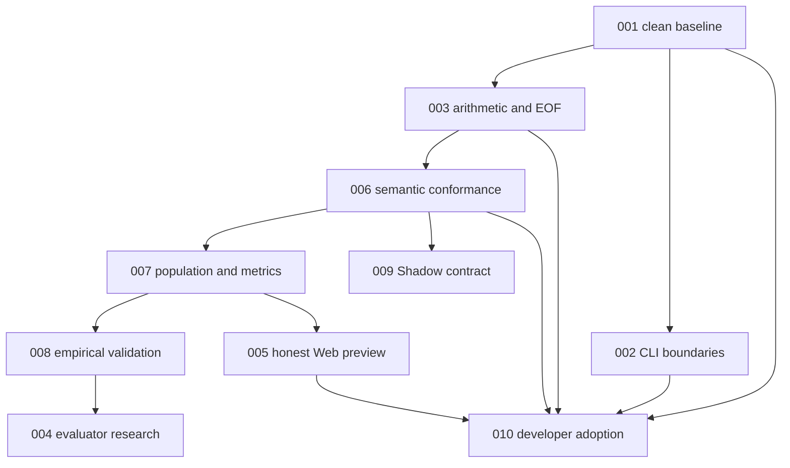

# FunnelScript Execution Plans

Assessment: 2026-10-31. These are advisor plans, not evidence that a feature is implemented. The application and research repositories intentionally mirror this planning set. `NEXT_PHASES.md` is the active direction; `docs/MASTER_PLAN.md` in the application is a historical architectural blueprint.

## Verified starting point

- Planning baseline was application `41f00f1` and research `abe561f` on `main`, with pre-existing staged and unstaged maintainer changes. Phase 001 preserved and reconciled those changes; the baseline SHAs are historical, not current release identifiers.
- Public distribution: tagged Git-source experimental preview `v0.2.0a1`. World declarations, typed rules/events, seeded sampling, local source imports, one-entry Marketing Standard Library and CLI `run-world` are implemented. PyPI, calibrated market forecasts, provider actions and `fpm` are not shipped.
- Phase 001 initially reproduced the same broken `academic-paper` entrypoint link in both checkouts. After correcting the entrypoint and the registry's internal relative link: application `uv run pytest -q` **219 passed, 58 subtests passed**; research `python3 -m unittest discover -s tests -v` **5 passed**. Both link failures are fixed, and no tests were weakened.
- Fresh Web Studio result: `cd apps/web && bun test` returned **1 passed**. It covers simple graph roundtrip only, not simulation correctness.
- These are verified local checkout results, not results for the published Git tag. Re-run the relevant suites after subsequent changes and before tagging any new preview.

## Priority-ordered execution queue

Statuses: `TODO`, `IN PROGRESS`, `BLOCKED`, `DONE`, `REJECTED`. Mark `DONE` only after evidence is recorded. Historical plan numbers are stable identifiers, **not** a reliable run order.

| Order | ID | Plan | Priority | Effort / change risk | Dependencies | Current status |
| ---: | ---: | --- | :---: | --- | --- | --- |
| 1 | 001 | [Restore skill bundle link integrity](001-fix-skill-bundle-integrity-and-links.md) | P1 | S / LOW | none | **DONE**, both full suites green |
| 2 | 002 | [Harden CLI error and input boundaries](002-harden-cli-exception-handling-and-payload-bounds.md) | P1 | M / MED | 001 green baseline | TODO |
| 3 | 003 | [Specify and test parser arithmetic and EOF safety](003-parser-boundary-safety-and-binary-expression-expansion.md) | P1 | M / MED | 001 green baseline; research gate | TODO |
| 4 | 005 | [Make Web Studio simulation claims honest](005-web-studio-canvas-to-dag-simulation-alignment.md) | P1 | M / MED | none for disclosure and deterministic preview; 007 for authoritative parity | TODO |
| 5 | 006 | [Establish World semantic conformance evidence](006-world-semantic-conformance.md) | P1 | M / MED | 003 | TODO |
| 6 | 007 | [Prove a population and metric contract](007-population-reference-contract.md) | P1 | L / HIGH | 006 | TODO |
| 7 | 010 | [Check independent developer-preview adoption](010-independent-preview-adoption.md) | P2 | M / LOW | 001, 002, 003, 005, 006 for a refreshed preview candidate | TODO |
| 8 | 008 | [Run an empirical validation pilot](008-empirical-calibration-pilot.md) | P1 | L / HIGH | 007; permitted real observations and data owner | BLOCKED on data availability for final validation |
| 9 | 009 | [Design non-mutating Shadow capabilities](009-shadow-capability-boundary.md) | P2 | M / HIGH | 006; independent authorization review before any external access | TODO (local mock design only) |
| 10 | 004 | [Design a falsifiable candidate evaluator, not automatic promotion](004-evaluator-driven-self-improving-ecosystem.md) | P2 | L / HIGH | 006, 007, 008 | BLOCKED until scientific comparison gate |

## Next executable action

**001 is complete.** Next: execute **002** as its own TDD change card to distinguish CLI parser errors from internal exceptions, bound `--event` JSON before decoding, and report export I/O errors correctly. Preserve valid user-selected output paths. Execute **003** separately after its parser research gate; neither is implemented by completing 001.

005 can begin independently with an honest preview label and non-parity tests, but do not claim that changing `Math.random` or traversing `logic_flow` makes the TypeScript engine equivalent to the Python runtime.

## Dependency and release rules

- Numeric IDs do not authorize skipping dependency checks. For 005, disclosure/seeded-demo work may happen before 007; claiming engine parity must wait for 007.
- Experimental **language** preview may be communicated after its own correctness, distribution and documentation gates. **Market predictions** need 007 and real-data 008. **Live actions** are not authorized by any existing plan.
- No hidden holdout is truly secret if candidate authors can read it from the same repository. Holdout access, scoring and leakage controls belong in the evaluator research plan.
- A hash-chain log may detect accidental edits, but without a trusted signing boundary it is not immutable or tamper-proof.

## Executor protocol

1. Read both relevant `AGENTS.md` files, the selected full plan, and its research references. Preserve the existing dirty worktree. Make a branch/worktree only after inspecting the user's staged changes; no force operations.
2. Before implementation, record the research anchor, falsifiable hypothesis, mathematical or type invariant, and input/output contract. Respect `DEC-008` and `DEC-009`: the language core stays domain-neutral; marketing economic rules are model/library-level.
3. Drift check must include *working tree and index*, not only commit-to-commit differences: `git status --short -- <paths>` and `git diff <planned-SHA> -- <paths>`; inspect untracked files separately. The old `git diff SHA..HEAD` check alone misses staged edits.
4. Implement tests with discriminating failure cases, run focused suites, then full relevant suites and smoke tests. Treat pre-existing failure as a blocker unless the plan explicitly targets it.
5. Reconcile accepted decisions, research specs/evals, `docs/MASTER_PLAN.md` and `failure-lessons/` **during the executor's later implementation phase** under the repositories' constitutions. This advisor pass edits only `plans/`.
6. Record observed commands, commit SHAs and test totals in the completion note. Never mark a plan DONE from a proposed command, an old test count, or passing static docs.

## Considered and rejected for the current milestone

- **Automatic self-modifying model promotion now**: rejected until comparable model outputs and held-out empirical validity exist; it would reward modeling artifacts, not demonstrated market accuracy.
- **Treat the browser simulator as an interchangeable reference engine**: rejected. It currently uses hardcoded AOV, first-audience selection, unseeded random draws and unused `agentsCount`.
- **Restrict CLI exports to a fixed repository directory**: rejected as a generic local CLI security rule; a user intentionally choosing an absolute output path is not traversal by itself. Validate errors and permission boundaries without breaking this legitimate contract.
- **Build `fpm`, LSP, provider integrations, PyPI, or a full cognitive-agent layer first**: deferred until the core language, distribution and model-evidence gates identify a concrete user need.

See [Required Next Phases](NEXT_PHASES.md) for the scientific progression, product claim boundaries, and explicit decision points.
